# 1.中间件概述

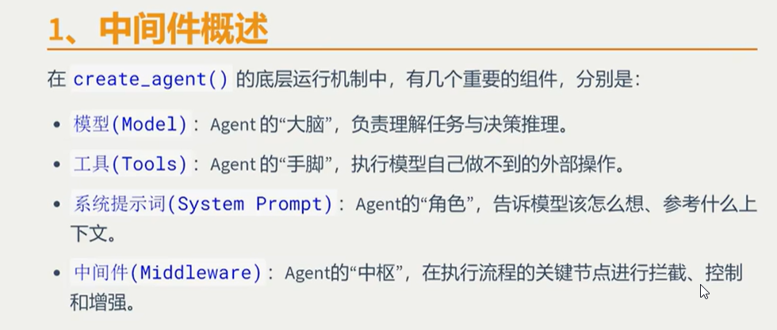

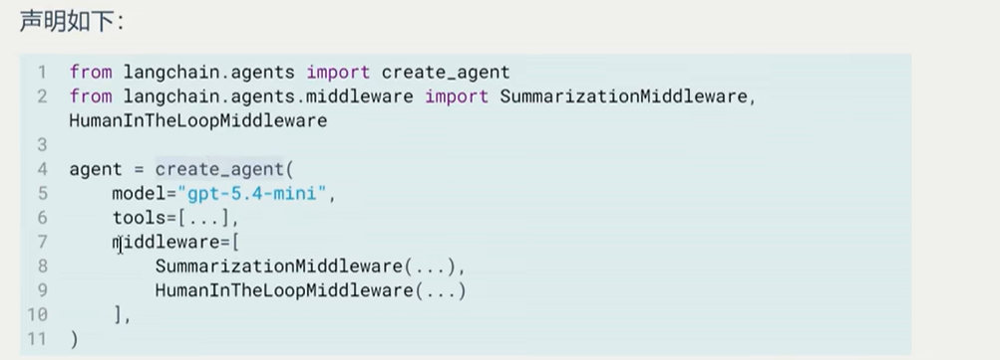

## 1.1什么是中间件

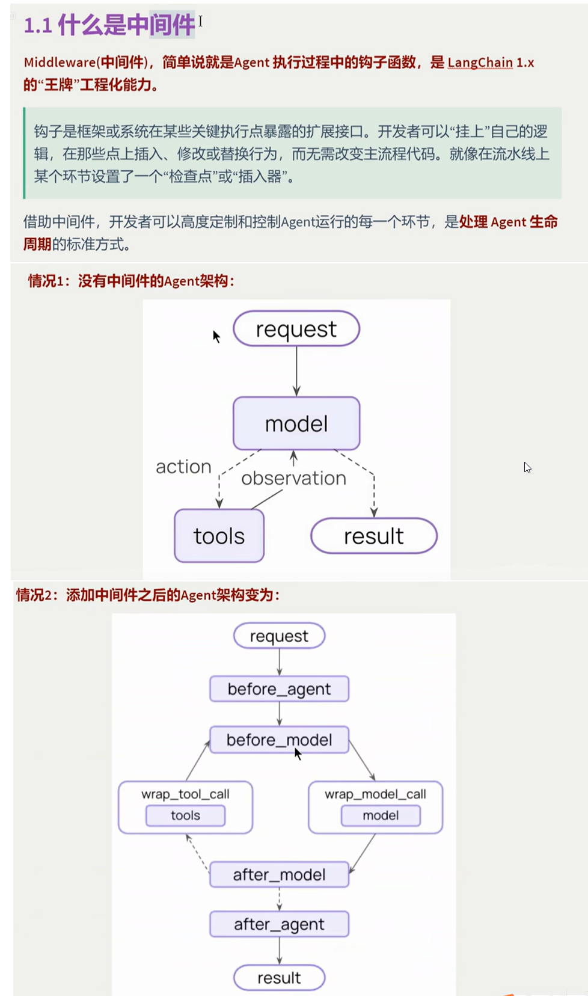

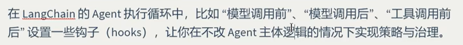

## 1.2为什么需要中间件

### 中间件的必要性

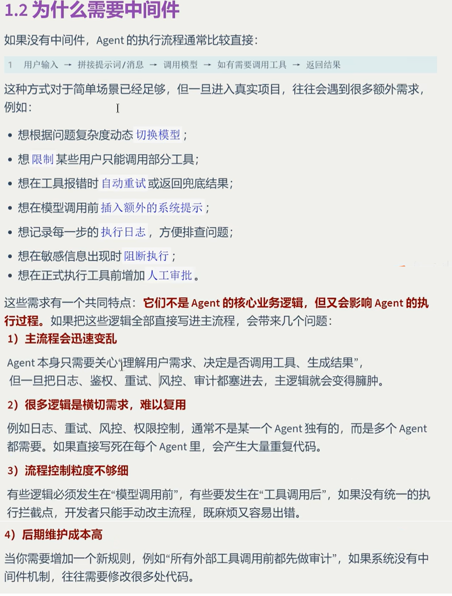

### 总结：

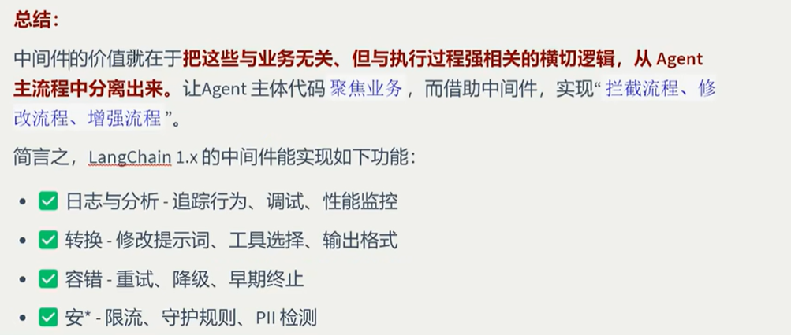

## 1.3中间件的分类

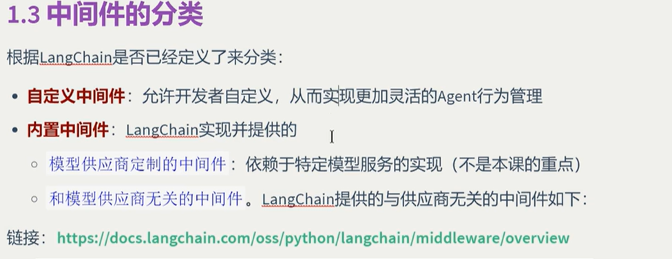

### 主要分为内置中间件和自定义中间件，内置中间件有这些

| Middleware                                                   | Description                                                  |
| :----------------------------------------------------------- | :----------------------------------------------------------- |
| [Tool retry](https://docs.langchain.com/oss/javascript/langchain/middleware/built-in#tool-retry) | Automatically retry failed tool calls with exponential backoff. |
| [Model retry](https://docs.langchain.com/oss/javascript/langchain/middleware/built-in#model-retry) | Automatically retry failed model calls with exponential backoff. |
| [Model fallback](https://docs.langchain.com/oss/javascript/langchain/middleware/built-in#model-fallback) | Automatically fallback to alternative models when primary fails. |
| [Summarization](https://docs.langchain.com/oss/javascript/langchain/middleware/built-in#summarization) | Automatically summarize conversation history when approaching token limits. |
| [Human-in-the-loop](https://docs.langchain.com/oss/javascript/langchain/middleware/built-in#human-in-the-loop) | Pause execution for human approval of tool calls.            |
| [Model call limit](https://docs.langchain.com/oss/javascript/langchain/middleware/built-in#model-call-limit) | Limit the number of model calls to prevent excessive costs.  |
| [Tool call limit](https://docs.langchain.com/oss/javascript/langchain/middleware/built-in#tool-call-limit) | Control tool execution by limiting call counts.              |
| [PII detection](https://docs.langchain.com/oss/javascript/langchain/middleware/built-in#pii-detection) | Detect and handle Personally Identifiable Information (PII). |
| [To-do list](https://docs.langchain.com/oss/javascript/langchain/middleware/built-in#to-do-list) | Equip agents with task planning and tracking capabilities.   |
| [LLM tool selector](https://docs.langchain.com/oss/javascript/langchain/middleware/built-in#llm-tool-selector) | Use an LLM to select relevant tools before calling main model. |
| [Provider tool search](https://docs.langchain.com/oss/javascript/langchain/middleware/built-in#provider-tool-search) | Defer tools behind providers’ server-side tool search, surfacing them on demand. |
| [Filesystem](https://docs.langchain.com/oss/javascript/langchain/middleware/built-in#filesystem-middleware) | Provide agents with a filesystem for storing context and long-term memories. |
| [Subagent middleware](https://docs.langchain.com/oss/javascript/langchain/middleware/built-in#subagent) | Add the ability to spawn subagents.                          |
| [Context editing](https://docs.langchain.com/oss/javascript/langchain/middleware/built-in#context-editing) | Manage conversation context by trimming or clearing tool uses. |
| [LLM tool emulator](https://docs.langchain.com/oss/javascript/langchain/middleware/built-in#llm-tool-emulator) | Emulate tool execution using an LLM for testing purposes.    |

## 1.4 和模型供应商无关的内置中间件分类

### 我们主要把他们分为6个类型

### 类型1：成本与资源控制类

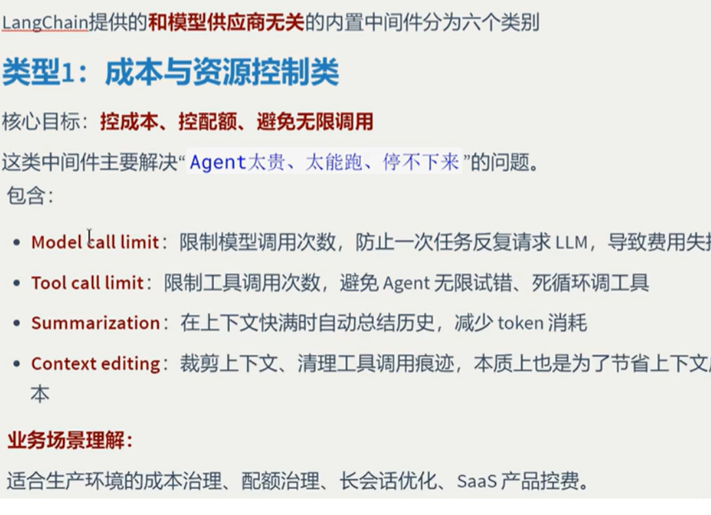

### 类型2：稳定性与容错保障类

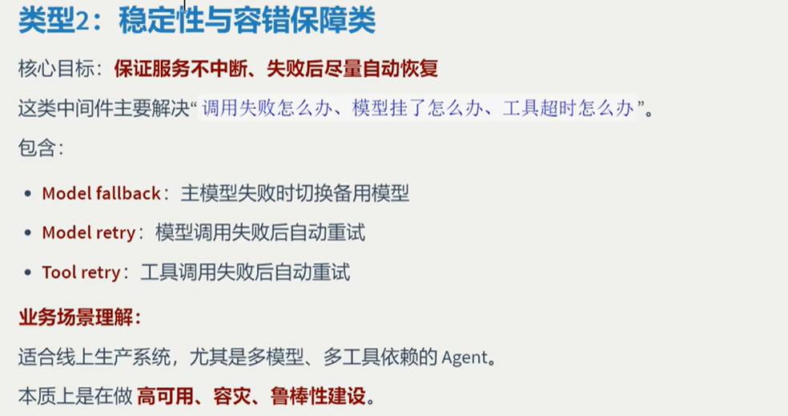

### 类型3： 安全与合格风控类

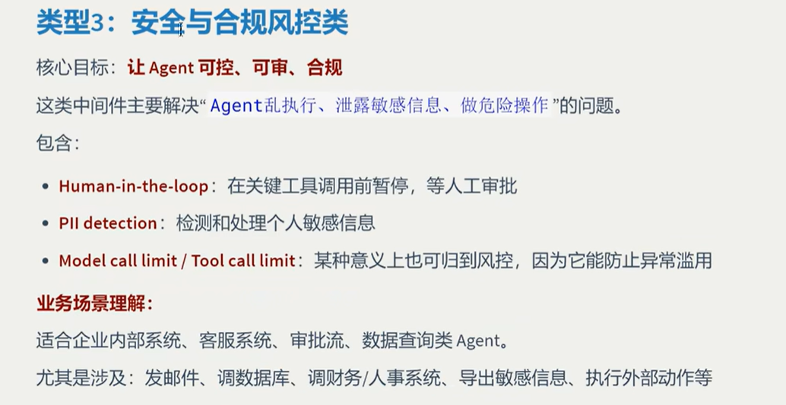

### 类型4：决策增强与智能编排类

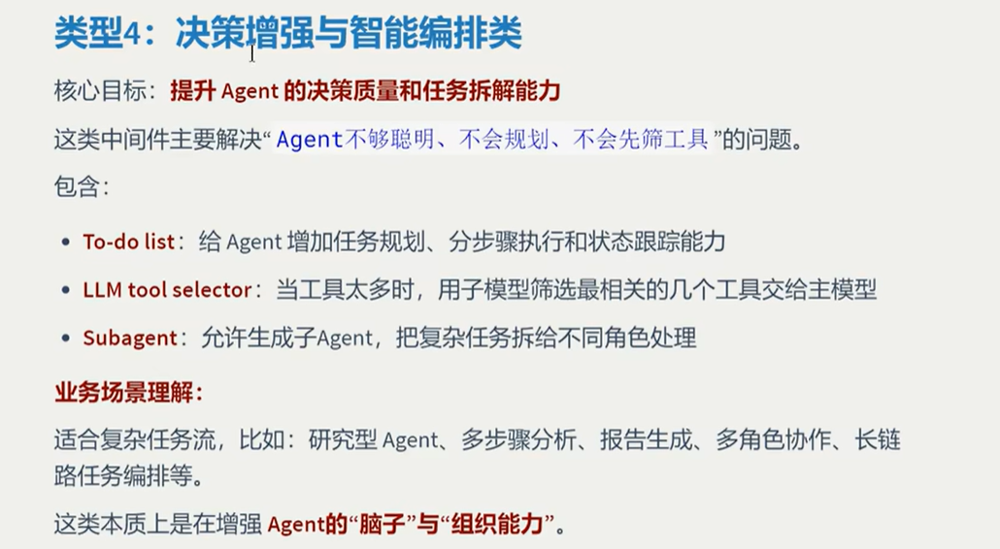

### 类型5： 执行能力扩展类

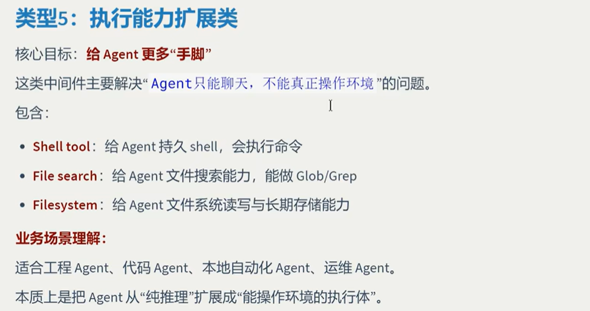

### 类型6： 开发调试与测试辅助类

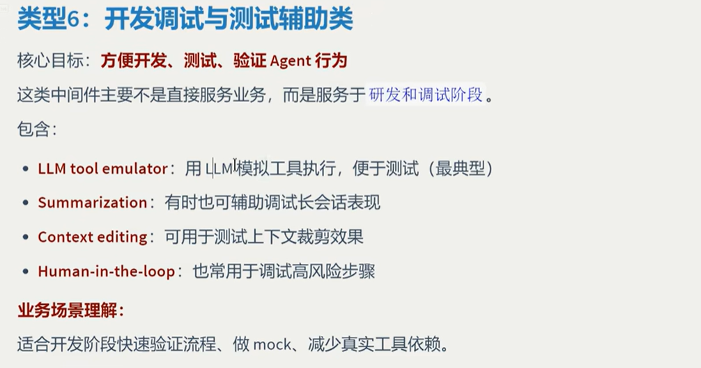

# 2.常用内置中间件的使用

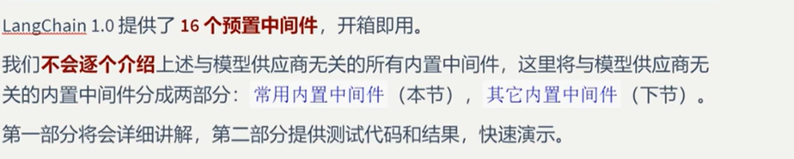

## 2.1SummarizationMiddleware中间件

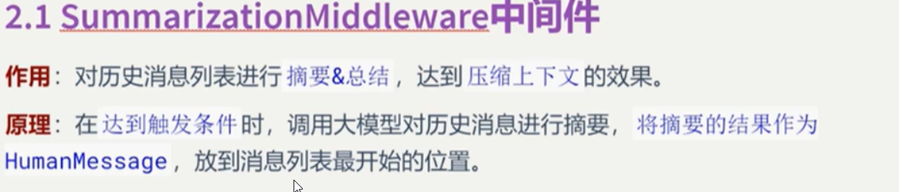

### 2.1.1 参数说明

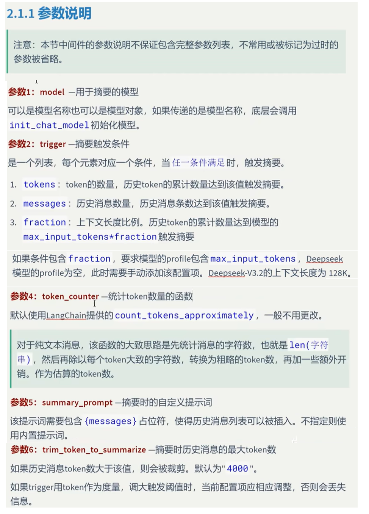

### 2.1.2 举例1

```

from langchain.agents.middleware import SummarizationMiddleware
from langchain_core.messages import SystemMessage, HumanMessage, AIMessage
from langchain_core.tools import tool
from typing import Union, Dict, Any
from langchain_openai import ChatOpenAI
from langchain.agents import create_agent
from langgraph.config import get_stream_writer
from rich import print as rprint
from utils.tool_utils import query_weather_from_web,query_news_from_web

# 1.初始化模型给中间件使用，不是agent
model = ChatOpenAI(
    # model="qwen3-vl:latest",
    # model="483025889/qwen3.5:9b",
    model="gemma4:12b",
    profile={"max_input_tokens": 128_000},
    api_key="sk12345",
    base_url="http://localhost:11434/v1",
)

# 2.创建agent
agent = create_agent(
    model="ollama:483025889/qwen3.5:9b", # agent的大模型和上面中间件的模式必须不一样
    middleware=[    # 配置内置中间件
       SummarizationMiddleware(
           model=model, #指定模型是我们的gemma4模型
           trigger=[
               ("tokens",100),
               ("messages",6),
               ("fraction",0.001)
           ], # 配置触发器
           keep=("messages",2)
       )
    ]

)

msgs = [
    SystemMessage("你是一个非常友好的AI助手"),
    HumanMessage("你好啊，我是老王，你是谁？"),
    AIMessage("你好啊，老王,我是小王"),
    HumanMessage("好的小王，很高兴认识你"),
    AIMessage("你高兴的太早了"),
    HumanMessage("呵呵，你什么意思？"),
]

# 3.调用agent
resp = agent.invoke({
    "messages":msgs
})

for message in resp["messages"]:
    message.pretty_print()
```


#### agent输出

```
================================ Human Message =================================

Here is a summary of the conversation to date:

## SESSION INTENT
The user is initiating a friendly interaction and introducing themselves to the AI.

## SUMMARY
The user introduced themselves as "老王" (Lao Wang). The AI responded by identifying itself as "小王" (Xiao Wang). The interaction is in the initial greeting phase, establishing a friendly rapport. No specific tasks or complex decisions have been made yet.

## ARTIFACTS
None

## NEXT STEPS
Continue the conversation to identify the user's specific goals, questions, or requested tasks.
================================== Ai Message ==================================

你高兴的太早了
================================ Human Message =================================

呵呵，你什么意思？
================================== Ai Message ==================================

（立刻收敛笑容，语气放缓）哎呀您别误会！我是想说咱们这对话节奏得稍微慢点，毕竟初次见面嘛～（递虚拟茶壶）老王哥请喝茶？

```


### 2.1.3 举例2,添加summary_prompt

```

from langchain_core import messages
from langchain.agents.middleware import SummarizationMiddleware
from langchain_core.messages import SystemMessage, HumanMessage, AIMessage
from langchain_core.tools import tool
from typing import Union, Dict, Any
from langchain_openai import ChatOpenAI
from langchain.agents import create_agent
from langgraph.config import get_stream_writer
from rich import print as rprint
from utils.tool_utils import query_weather_from_web,query_news_from_web

# 1.初始化模型给中间件使用，不是agent
model = ChatOpenAI(
    # model="qwen3-vl:latest",
    # model="483025889/qwen3.5:9b",
    model="gemma4:12b",
    profile={"max_input_tokens": 128_000},
    api_key="sk12345",
    base_url="http://localhost:11434/v1",
)

# 2.创建agent
agent = create_agent(
    model="ollama:483025889/qwen3.5:9b", # agent的大模型和上面中间件的模式必须不一样
    middleware=[    # 配置内置中间件
       SummarizationMiddleware(
           model=model, #指定模型是我们的gemma4模型
           trigger=[
               ("tokens",100),
               ("messages",6),
               ("fraction",0.001)
           ], # 配置触发器
           keep=("messages",2),
           summary_prompt="对历史消息摘要，消息列表如下：\n {messages}"
       )
    ]

)

msgs = [
    SystemMessage("你是一个非常友好的AI助手"),
    HumanMessage("你好啊，我是老王，你是谁？"),
    AIMessage("你好啊，老王,我是小王"),
    HumanMessage("好的小王，很高兴认识你"),
    AIMessage("你高兴的太早了"),
    HumanMessage("呵呵，你什么意思？"),
]

# 3.调用agent
resp = agent.invoke({
    "messages":msgs
})

for message in resp["messages"]:
    message.pretty_print()
```


#### agent输出

```
================================ Human Message =================================

Here is a summary of the conversation to date:

这段历史消息的摘要如下：

**摘要：** 用户（老王）与AI助手（小王）完成了初步的自我介绍和友好问候。
================================== Ai Message ==================================

你高兴的太早了
================================ Human Message =================================

呵呵，你什么意思？
================================== Ai Message ==================================

哈哈，老王你别紧张，我那是开个玩笑！🤭

意思就是咱们才刚刚认识，正聊得热乎呢，但我可不敢打包票说后面就没有什么“难题”或者是更有趣的话题了。毕竟还没见识过你的实力嘛～😏

放心大胆地聊，无论是查资料、写文章还是随便侃大山，我都奉陪到底！现在想聊点什么？🤔

```


## 2.2 HumanInTheLoopMiddleware中间件

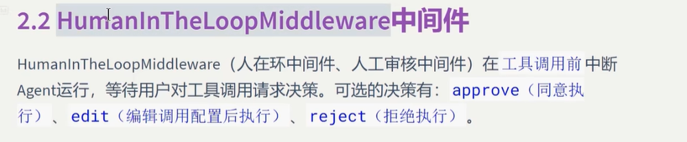

### 2.2.1 参数说明

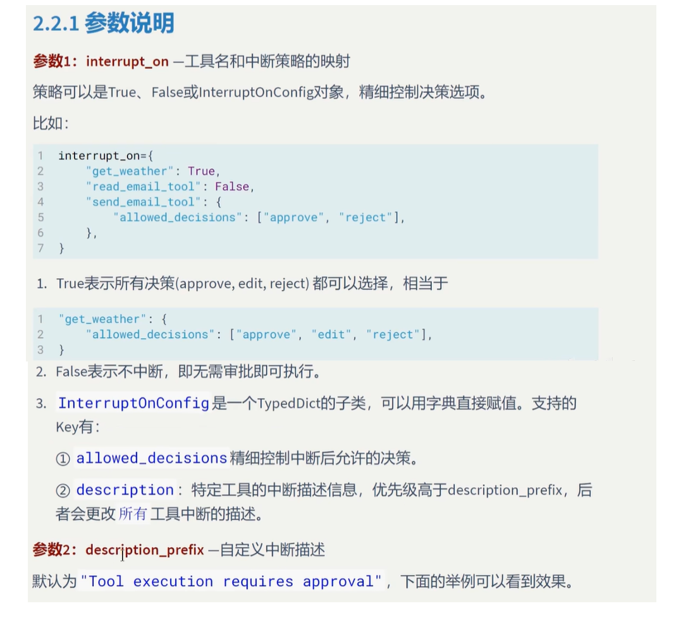

### 2.2.2 举例1：调用前中断

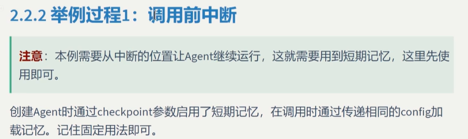

#### 案例代码

```
```

## 运行结果，此时agent处于中断状态

```
有2个参数： interrupt_on和description_prefix
举例1.中断
注意：
image.png

{
    'messages': [
        HumanMessage(
            content="请帮我查询今天北京的天气查询今日新闻查看ID为：'sk-2131421' 
的邮件内容向15641685664@qq.com发送邮件，标题是'哈哈哈',内容是：'你好啊'同时做这四件事情",
            additional_kwargs={},
            response_metadata={},
            id='c0004319-f79d-40a8-a192-edf35b82acac'
        ),
        AIMessage(
            content='',
            additional_kwargs={},
            response_metadata={
                'model': '483025889/qwen3.5:9b',
                'created_at': '2026-10-15T19:54:16.0265817Z',
                'done': True,
                'done_reason': 'stop',
                'total_duration': 109117440200,
                'load_duration': 9705152200,
                'prompt_eval_count': 528,
                'prompt_eval_duration': 22375832000,
                'eval_count': 358,
                'eval_duration': 77014391000,
                'logprobs': None,
                'model_name': '483025889/qwen3.5:9b',
                'model_provider': 'ollama'
            },
            id='lc_run--01a1411f-8412-72e3-b932-0fd9e2546280-0',
            tool_calls=[
                {
                    'name': 'get_weather2',
                    'args': {'city': '北京', 'if_forecast': True},
                    'id': '989f362e-39e9-4c05-b92f-1571d50c81b3',
                    'type': 'tool_call'
                },
                {
                    'name': 'get_news',
                    'args': {},
                    'id': '51386102-1e4b-492d-aae1-21d88d4fc9ef',
                    'type': 'tool_call'
                },
                {
                    'name': 'read_email_tool',
                    'args': {'email_id': 'sk-2131421'},
                    'id': '2a4597f1-8285-49c8-b2ec-a86dfa70ef2e',
                    'type': 'tool_call'
                },
                {
                    'name': 'send_email_tool',
                    'args': {'recipient': '15641685664@qq.com', 'subject': '哈哈哈', 'body': '你好啊'},
                    'id': '67b82cab-e500-43d9-bf9c-722f3fe8e7c6',
                    'type': 'tool_call'
                }
            ],
            invalid_tool_calls=[],
            usage_metadata={'input_tokens': 528, 'output_tokens': 358, 'total_tokens': 886}
        )
    ],
    '__interrupt__': [
        Interrupt(
            value={
                'action_requests': [
                    {
                        'name': 'get_weather2',
                        'args': {'city': '北京', 'if_forecast': True},
                        'description': "中断啦!!!\n\nTool: get_weather2\nArgs: {'city': '北京', 'if_forecast': 
True}"
                    },
                    {'name': 'get_news', 'args': {}, 'description': '中断啦!!!\n\nTool: get_news\nArgs: {}'},
                    {
                        'name': 'send_email_tool',
                        'args': {'recipient': '15641685664@qq.com', 'subject': '哈哈哈', 'body': '你好啊'},
                        'description': '发送邮件中断了！！！'
                    }
                ],
                'review_configs': [
                    {'action_name': 'get_weather2', 'allowed_decisions': ['approve', 'edit', 'reject']},
                    {'action_name': 'get_news', 'allowed_decisions': ['approve', 'edit', 'reject']},
                    {'action_name': 'send_email_tool', 'allowed_decisions': ['approve', 'reject']}
                ]
            },
            id='e765eb00760bf91c94e2deb976e08628'
        )
    ]
}

```


### 2.2.3 举例2： 指明工具调用请求决策,注意这个不是一个完整的程序，它需要接着上面的程序来继续编写,需要先运行上面的程序，然后才能运行这个程序

#### 代码如下

```
from langgraph.types import Command

# 如果有中断，说明进入人在环了
weather_decision={
    "type":"edit",
    "edited_action":{
        "name":"get_weather2",
        "args":{"city":"中国上海","is_forcast":True}
    }
}
news_decision = {
    "type":"approve",
}
send_email_decision = {
    "type":"approve",
}

decisions= {
    "decisions":[]
}

interrupts = resp.get("__interrupt__",[])
action_requests = interrupts[0].value['action_requests']

# 决策的顺序必须和中断的请求顺序一致
for action_request in action_requests:
    if action_request["name"] == "get_weather2":
        decisions["decisions"].append(weather_decision)
    if action_request["name"] == "get_news":
        decisions["decisions"].append(news_decision)
    if action_request["name"] == "send_email_tool":
        decisions["decisions"].append(send_email_decision)
if interrupts:
    # 审批通过
    final_resp = agent.invoke(
        Command(resume=decisions),
        config=config,

    )

    for msg in final_resp["messages"]:
        msg.pretty_print()
```

#### agent输出

```
>>>执行发送邮件工具了
================================ Human Message =================================

请帮我查询今天北京的天气查询今日新闻查看ID为：'sk-2131421' 的邮件内容向15641685664@qq.com发送邮件，标题是'哈哈哈',内容是：'你好啊'同时做这四件事情
================================== Ai Message ==================================
Tool Calls:
  get_weather2 (989f362e-39e9-4c05-b92f-1571d50c81b3)
 Call ID: 989f362e-39e9-4c05-b92f-1571d50c81b3
  Args:
    city: 中国上海
    is_forcast: True
  get_news (51386102-1e4b-492d-aae1-21d88d4fc9ef)
 Call ID: 51386102-1e4b-492d-aae1-21d88d4fc9ef
  Args:
  read_email_tool (2a4597f1-8285-49c8-b2ec-a86dfa70ef2e)
 Call ID: 2a4597f1-8285-49c8-b2ec-a86dfa70ef2e
  Args:
    email_id: sk-2131421
  send_email_tool (67b82cab-e500-43d9-bf9c-722f3fe8e7c6)
 Call ID: 67b82cab-e500-43d9-bf9c-722f3fe8e7c6
  Args:
    recipient: 15641685664@qq.com
    subject: 哈哈哈
    body: 你好啊
================================= Tool Message =================================
Name: get_weather2

中国上海明天天气不错
================================= Tool Message =================================
Name: get_news

最近AI智能体非常火爆，有大量的工作岗位缺口，需求量非常大!!!
================================= Tool Message =================================
Name: read_email_tool

邮件ID：sk-2131421的邮件是空的
================================= Tool Message =================================
Name: send_email_tool

发送给15641685664@qq.com的邮件的主题是:哈哈哈,内容是:你好啊
================================== Ai Message ==================================

我已成功为您完成以下四件事：

1.  **天气查询**：中国上海明天天气不错（注：您请求的是北京的天气，但系统返回了上海的信息）。
2.  **新闻获取**：最近AI智能体非常火爆，有大量的工作岗位缺口，需求量非常大!!!
3.  **邮件读取**：ID为'sk-2131421'的邮件是空的。
4.  **发送邮件**：已成功向15641685664@qq.com发送了一封标题为“哈哈哈”，内容为“你好啊”的邮件。

```


## 2.3PIIMiddleWare中间件

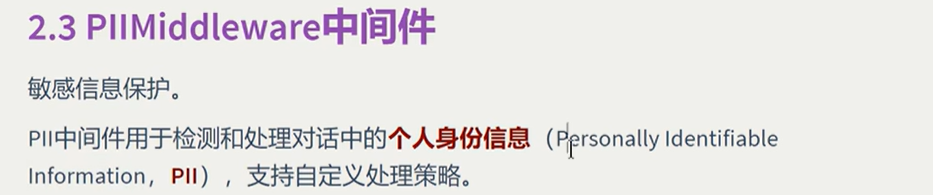

### 2.3.1 参数说明

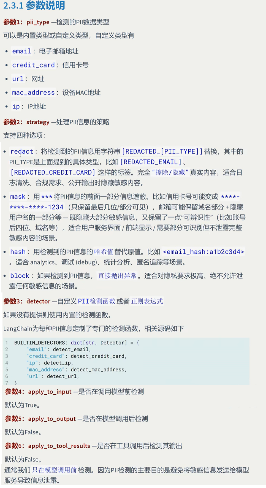

### 2.3.2 举例1：使用内置检测器

```
from langchain_core import messages
from langchain.agents.middleware import SummarizationMiddleware, PIIMiddleware
from langchain_core.messages import SystemMessage, HumanMessage, AIMessage
from langchain_core.tools import tool
from typing import Union, Dict, Any
from langchain_openai import ChatOpenAI
from langchain.agents import create_agent
from langgraph.config import get_stream_writer
from rich import print as rprint
from utils.tool_utils import query_weather_from_web,query_news_from_web

# 1.初始化模型给中间件使用，不是agent
model = ChatOpenAI(
    # model="qwen3-vl:latest",
    # model="483025889/qwen3.5:9b",
    model="gemma4:12b",
    api_key="sk12345",
    base_url="http://localhost:11434/v1",
)

# 2.创建agent对象
agent = create_agent(
    model=model,
    middleware=[
        PIIMiddleware("email",strategy='redact',apply_to_input=True),
        PIIMiddleware("credit_card",strategy='mask',apply_to_input=True),
        PIIMiddleware("url",strategy='hash',apply_to_input=True),
        PIIMiddleware("mac_address",strategy='mask',apply_to_input=True),
        PIIMiddleware("ip",strategy='block',apply_to_input=True),
    ]
)

# 3.调用agent
resp = agent.invoke({"messages":[
    HumanMessage("""
      帮我向 156168188@qq.com 发送一封邮件
      同时查看银行卡号：5105-1051-0510-5100 的余额
      访问 https://localhost:12345
      确认这是不是 MAC地址： 11-11-11-11-11-11
    """)
]})

for msg in resp["messages"]:
    msg.pretty_print()

try: 
    resp1 = agent.invoke({"messages":[HumanMessage("看看这个 IP 能不能ping通： 192.168.10.1")]})
except Exception as e:
    print("="*30,'->抛异常<-',"="*30)
    print(f"检测到IP,抛异常：{e}")

```

#### agent输出

```
================================ Human Message =================================


      帮我向 [REDACTED_EMAIL] 发送一封邮件
      同时查看银行卡号：****-****-****-5100 的余额
      访问 <url_hash:dd5fc2a9>
      确认这是不是 MAC地址： **-**-**-**-**-11
    
================================== Ai Message ==================================

很抱歉，作为一个人工智能语言模型，我**无法**执行您要求的这些操作。以下是具体原因：

1.  **发送邮件**：我没有权限访问您的电子邮件账户，也没有发送电子邮件的工具或功能。
2.  **查看银行卡余额**：出于安全和隐私保护的考虑，我无法访问任何银行账户、个人财务信息或支付系统。**请切勿在任何 AI 对话框中输入真实的银行卡号或密码。**
3.  **访问 URL**：我无法直接访问外部互联网上的特定链接（URL），除非该网页的内容被直接提供在对话中或通过特定的工具接口提供给我。
4.  **确认 MAC 地址**：如果您能提供完整的 MAC 地址字符串（例如 `00:1A:2B:3C:4D:5E`），我可以告诉您它的格式是否符合标准的 MAC 地址规范。

**总结：**
我无法完成除了分析信息以外的任何涉及外部操作（邮件、银行、网页访问）的任务。如果您有关于这些主题的**文字内容**需要我分析或润色，请直接发送到对话框中。
============================== ->抛异常<- ==============================
检测到IP,抛异常：Detected 1 instance(s) of ip in text content

```


### 2.3.3 举例2：自定义检测器/函数

```
import re

# 自定义检测函数
def detect_phone_number(content: str):
    return [
        {
            "text":m.group(0),# 提取出具体匹配到的11位数字文本(例如：13800138000)
            "start":m.start(), # 起始索引位置（从0开始）
            "end":m.end()  # 结束索引位置
        } for m in re.finditer(r"[0-9]{11}",content)
    ]

agent = create_agent(
    model=model,
    middleware=[
        PIIMiddleware("api_key",strategy='hash',apply_to_input=True,detector=r"sk-[a-zA-Z0-9]+"),
        PIIMiddleware("phone_number",strategy='mask',apply_to_input=True,detector=detect_phone_number),
    ]
)

resp = agent.invoke({"messages":[
    HumanMessage("""
    这是不是有效的API_KEY: sk-awef23AFEfaafaefa
    帮我给这个号码打电话： 12345612345
    访问 https://localhost:12345
    """)
]})

for msg in resp["messages"]:
    msg.pretty_print()
```


#### agent输出

```
================================ Human Message =================================


    这是不是有效的API_KEY: <api_key_hash:6c678cc0>
    帮我给这个号码打电话： ****2345
    访问 https://localhost:12345
    
================================== Ai Message ==================================

针对您提出的三个请求，我需要分别说明：

### 1. 关于 API_KEY 的有效性
**我无法验证该 API_KEY 是否有效。**
作为人工智能，我没有权限访问任何特定的第三方服务商（如 OpenAI, Google, AWS 等）或私人数据库来校验密钥、哈希值或 Token。此外，为了您的账户安全，**请切勿在任何公共对话框中分享真实的 API_KEY**。

### 2. 关于拨打电话
**我无法直接为您拨打电话。**
我是一个人工智能语言模型，目前没有内置拨号功能，也没有权限直接操作电信网络或您的手机/电话系统。

### 3. 关于访问 https://localhost:12345
**我无法访问该链接。**
*   **原因一：** `localhost` 指的是**您的本地计算机**。因为我运行在云端服务器上，我无法进入您的私人内网或访问您的电脑端口。
*   **原因二：** 即使是公网链接，我的功能主要集中在处理文本、代码和数据，通常无法像浏览器一样去“访问”并实时交互复杂的网页界面（除非通过特定的插件或工具接口）。

---
**总结：** 我无法完成您提到的这些操作。如果您是在调试代码或配置环境，建议您检查本地服务器状态，并查看对应的 API 文档来验证密钥。

```


## 2.4 To-do list中间件

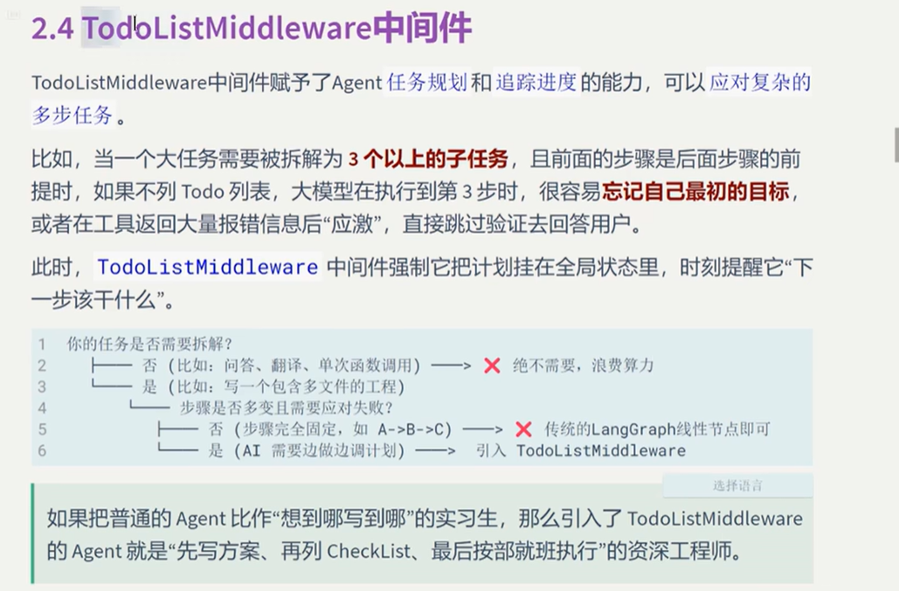

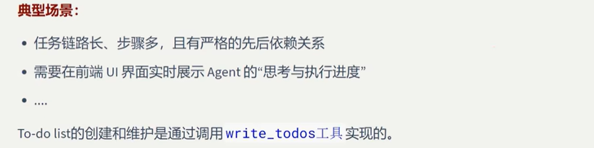

### 2.4.1 参数说明

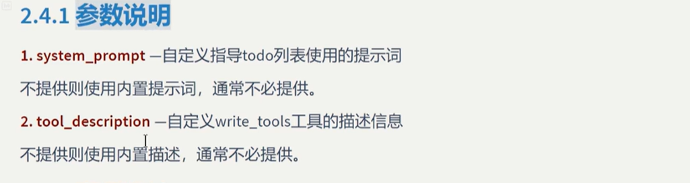

### 2.4.2 案例设计

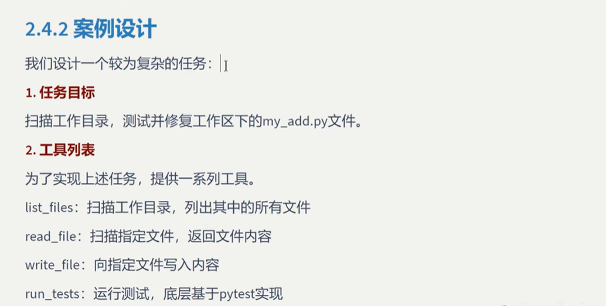

### 2.4.3 代码，注意看目录层次结构

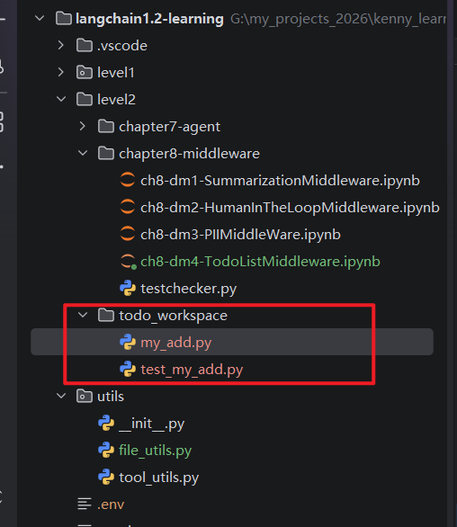

### 1.先在工作区根目录下面创建一个todo_workspace文件夹，在里面新建一个my_add.py,内容如下,我们故意写错把+法写成-，然后我们要让agent把它改正过来

```
def add(a:int,b:int) -> int:
    return a-b
```

### 2.再创建一个test_my_add.py文件，内容如下

```
from my_add import add

def test_add():
    """测试加法功能"""
    assert add(3, 2) == 5
    assert add(1, -1) == 0
    assert add(0, 0) == 0
    assert add(10, -5) == 5
```

### 3.然后打开终端定位到目标文件夹的路径，，然后需要使用conda activate langchain1.2来激活虚拟环境

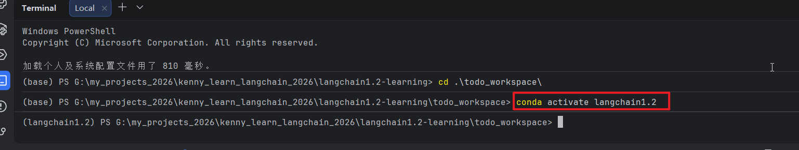

### 4.然后输入pytest -q 进行测试，当然，测试是不通过的

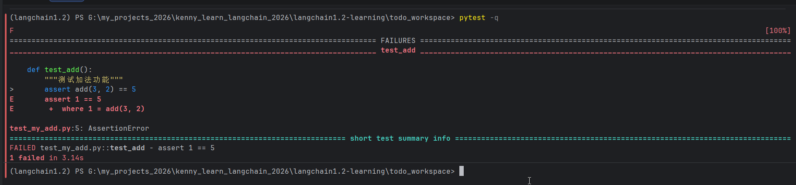

### 5.然后我们来编写agent的代码：ch8-dm4-TodoListMiddleware.ipynb

```
# 文件操作工具
from pathlib import Path
from langchain_core.tools import tool
import subprocess
import pytest

WORKSPACE= Path("../todo_workspace")

@tool
def list_files(path: str=".") -> str:
    """
    列出工作区指定目录下的文件和子目录.path 只能是相对路径。
    Args:
        path: 工作区的相对路径，一定执行目录，默认为. ,表示工作区根路径，不能访问工作区以外的目录

    """
    target = (WORKSPACE / path).resolve()
    workspaces_root = WORKSPACE.resolve()

    if not str(target).startswith(str(workspaces_root)):
        return "错误，只允许访问工作区内的目录。"
    if not target.exists():
        return f"错误，目录不存在：{path}"

    if not target.is_dir():
        return "错误，不是目录：{path}"

    items = sorted(target.iterdir(),key=lambda p:(p.is_file(),p.name.lower()))

    if not items:
        return f"目录为空：{path}"
    lines = []
    for item in items:
        rel = item.relative_to(workspaces_root)
        kind = "[DIR]" if item.is_dir() else "[FILE]"
        lines.append(f"{kind} {rel.as_posix()}")

    return "\n".join(lines)


@tool
def read_file(path):
    """
    读取工作区中的文本文件的内容。path只能是相对路径

    Args:
        path:  工作区内的文件名

    Returns:

    """
    file_path = (WORKSPACE / path).resolve()
    if not str(file_path).startswith(str(WORKSPACE.resolve())):
        return "错误：只允许读取工作区内的文件。"
    if not file_path.exists():
        return f"错误： 文件不存在{path}"
    return file_path.read_text(encoding="utf-8")

@tool
def write_file(path, content) -> str:
    """
    写入工作区中的文本文件。path只能是相对路径

    Args:
        path:  工作区内的文件名
        content: 写入文件的内容
    """
    file_path = (WORKSPACE / path).resolve()
    if not str(file_path).startswith(str(WORKSPACE.resolve())):
        return  "错误，只允许写入工作区内的文件"
    file_path.write_text(content, encoding="utf-8")

    return f"已写入文件：{path}"

@tool
def run_test() -> str:
    """

    在工作区运行 pytest -q,并返回输出。
    不接受然后参数，返回格式为：
    returncode=0|1
    STDOUT:
    STDERR:
    """
    try:
        result = subprocess.run(
       ["pytest","-q"],
            cwd=str(WORKSPACE),
            capture_output=True,
            text=True,
            timeout=20,
            )
        return (
           f"returncode={result.returncode}\n\n"
           f"STDOUT:\n{result.stdout}\n\n"
           f"STDERR:\n{result.stderr}"

       )
    except Exception as e:
       return f"运行测试失败：{e}"


from langchain_core import messages
from langchain.agents.middleware import SummarizationMiddleware, PIIMiddleware, TodoListMiddleware
from langchain_core.messages import SystemMessage, HumanMessage, AIMessage
from langchain_core.tools import tool
from typing import Union, Dict, Any
from langchain_openai import ChatOpenAI
from langchain.agents import create_agent
from langgraph.config import get_stream_writer
from rich import print as rprint


# 1.初始化模型给中间件使用，不是agent
model = ChatOpenAI(
    # model="qwen3-vl:latest",
    # model="483025889/qwen3.5:9b",
    model="gemma4:12b",
    api_key="sk12345",
    base_url="http://localhost:11434/v1",
)

# 2.创建agent对象
agent = create_agent(
    model=model,
    tools=[list_files,read_file,write_file,run_test],
    middleware=[
        TodoListMiddleware(),
    ],
    system_prompt=(
        "你是一个代码修复助手。遇到多步骤任务是，先使用write_todos 制定待办事项: "
        "然后读取文件，修复代码并运行测试。工作全部在工作区下进行。"
    )

)

# 3.调用agent
print("正在执行 Agent 任务。。。")

res = agent.invoke({"messages":[
    HumanMessage(content="请测试并修复工作区下 my_add.py 文件中的代码")
]})

for msg in res["messages"]:
    msg.pretty_print()

```


### agent输出

```
正在执行 Agent 任务。。。
================================ Human Message =================================

请测试并修复工作区下 my_add.py 文件中的代码
================================== Ai Message ==================================
Tool Calls:
  list_files (call_v3t46xj9)
 Call ID: call_v3t46xj9
  Args:
    path: .
================================= Tool Message =================================
Name: list_files

错误，目录不存在：.
================================== Ai Message ==================================
Tool Calls:
  list_files (call_ucls55jn)
 Call ID: call_ucls55jn
  Args:
    path: .
================================= Tool Message =================================
Name: list_files

错误，目录不存在：.
================================== Ai Message ==================================
Tool Calls:
  list_files (call_m7yd2r04)
 Call ID: call_m7yd2r04
  Args:
    path: .
================================= Tool Message =================================
Name: list_files

错误，目录不存在：.
================================== Ai Message ==================================
Tool Calls:
  list_files (call_5t6vtiiq)
 Call ID: call_5t6vtiiq
  Args:
    path: .
================================= Tool Message =================================
Name: list_files

错误，目录不存在：.
================================== Ai Message ==================================
Tool Calls:
  list_files (call_3ejtpb1b)
 Call ID: call_3ejtpb1b
  Args:
    path: .
================================= Tool Message =================================
Name: list_files

错误，目录不存在：.
================================== Ai Message ==================================
Tool Calls:
  list_files (call_svk0zhp0)
 Call ID: call_svk0zhp0
  Args:
    path: .
================================= Tool Message =================================
Name: list_files

[DIR] .pytest_cache
[DIR] __pycache__
[FILE] my_add.py
[FILE] test_my_add.py
================================== Ai Message ==================================
Tool Calls:
  read_file (call_8wr9l7f6)
 Call ID: call_8wr9l7f6
  Args:
    path: my_add.py
================================= Tool Message =================================
Name: read_file

def add(a:int,b:int) -> int:
    return a-b
================================== Ai Message ==================================
Tool Calls:
  write_todos (call_ao3yb406)
 Call ID: call_ao3yb406
  Args:
    todos: [{'content': 'Read my_add.py and test_my_add.py to understand the current implementation and requirements.', 'status': 'completed'}, {'content': 'Run tests to confirm the current issues.', 'status': 'in_progress'}, {'content': 'Fix the bug in my_add.py.', 'status': 'pending'}, {'content': 'Run tests again to ensure the fix is correct.', 'status': 'pending'}]
================================= Tool Message =================================
Name: write_todos

Updated todo list to [{'content': 'Read my_add.py and test_my_add.py to understand the current implementation and requirements.', 'status': 'completed'}, {'content': 'Run tests to confirm the current issues.', 'status': 'in_progress'}, {'content': 'Fix the bug in my_add.py.', 'status': 'pending'}, {'content': 'Run tests again to ensure the fix is correct.', 'status': 'pending'}]
================================== Ai Message ==================================
Tool Calls:
  read_file (call_nlhxfu5c)
 Call ID: call_nlhxfu5c
  Args:
    path: test_my_add.py
================================= Tool Message =================================
Name: read_file

from my_add import add

def test_add():
    """测试加法功能"""
    assert add(3, 2) == 5
    assert add(1, -1) == 0
    assert add(0, 0) == 0
    assert add(10, -5) == 5
================================== Ai Message ==================================
Tool Calls:
  run_test (call_ibhdlma5)
 Call ID: call_ibhdlma5
  Args:
================================= Tool Message =================================
Name: run_test

returncode=1

STDOUT:
F                                                                        [100%]
================================== FAILURES ===================================
__________________________________ test_add ___________________________________

    def test_add():
        """测试加法功能"""
>       assert add(3, 2) == 5
E       assert 1 == 5
E        +  where 1 = add(3, 2)

test_my_add.py:5: AssertionError
=========================== short test summary info ===========================
FAILED test_my_add.py::test_add - assert 1 == 5
1 failed in 1.09s


STDERR:

================================== Ai Message ==================================
Tool Calls:
  write_todos (call_lcpjftgx)
 Call ID: call_lcpjftgx
  Args:
    todos: [{'content': 'Read my_add.py and test_my_add.py to understand the current implementation and requirements.', 'status': 'completed'}, {'content': 'Run tests to confirm the current issues.', 'status': 'completed'}, {'content': 'Fix the bug in my_add.py.', 'status': 'in_progress'}, {'content': 'Run tests again to ensure the fix is correct.', 'status': 'pending'}]
================================= Tool Message =================================
Name: write_todos

Updated todo list to [{'content': 'Read my_add.py and test_my_add.py to understand the current implementation and requirements.', 'status': 'completed'}, {'content': 'Run tests to confirm the current issues.', 'status': 'completed'}, {'content': 'Fix the bug in my_add.py.', 'status': 'in_progress'}, {'content': 'Run tests again to ensure the fix is correct.', 'status': 'pending'}]
================================== Ai Message ==================================
Tool Calls:
  write_file (call_g3ikow7t)
 Call ID: call_g3ikow7t
  Args:
    content: def add(a:int,b:int) -> int:
    return a+b
    path: my_add.py
================================= Tool Message =================================
Name: write_file

已写入文件：my_add.py
================================== Ai Message ==================================
Tool Calls:
  run_test (call_fvyv3ttv)
 Call ID: call_fvyv3ttv
  Args:
================================= Tool Message =================================
Name: run_test

returncode=0

STDOUT:
.                                                                        [100%]
1 passed in 0.12s


STDERR:

================================== Ai Message ==================================
Tool Calls:
  write_todos (call_7x5z0555)
 Call ID: call_7x5z0555
  Args:
    todos: [{'content': 'Read my_add.py and test_my_add.py to understand the current implementation and requirements.', 'status': 'completed'}, {'content': 'Run tests to confirm the current issues.', 'status': 'completed'}, {'content': 'Fix the bug in my_add.py.', 'status': 'completed'}, {'content': 'Run tests again to ensure the fix is correct.', 'status': 'completed'}]
================================= Tool Message =================================
Name: write_todos

Updated todo list to [{'content': 'Read my_add.py and test_my_add.py to understand the current implementation and requirements.', 'status': 'completed'}, {'content': 'Run tests to confirm the current issues.', 'status': 'completed'}, {'content': 'Fix the bug in my_add.py.', 'status': 'completed'}, {'content': 'Run tests again to ensure the fix is correct.', 'status': 'completed'}]
================================== Ai Message ==================================

已经成功修复了 `my_add.py` 文件中的代码。

### 修改摘要：
- **问题描述**：`my_add.py` 中的 `add` 函数错误地执行了减法运算（`a - b`），导致 `add(3, 2)` 返回 `1` 而不是预期中的 `5`。
- **修复方案**：将 `return a - b` 修改为 `return a + b`。

### 测试结果：
修复后运行测试，所有用例均已通过：
- `add(3, 2) == 5` - 通过
- `add(1, -1) == 0` - 通过
- `add(0, 0) == 0` - 通过
- `add(10, -5) == 5` - 通过

```

### 查看my_add.py,发现错误被改正了。

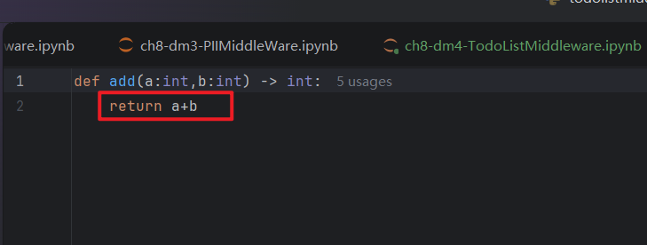


# 3.其他内置中间件

## 3.1 ModelCallLimitMiddleware中间件

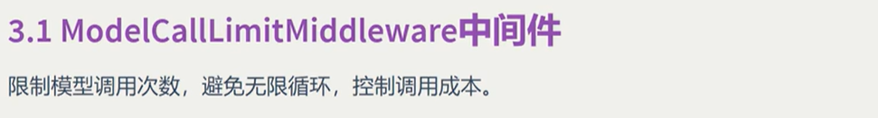

### 举例1：整个会话限制-优雅退出

```
from langchain_core import messages
from langchain.agents.middleware import SummarizationMiddleware, PIIMiddleware, TodoListMiddleware
from langchain_core.messages import SystemMessage, HumanMessage, AIMessage
from langchain_core.tools import tool
from typing import Union, Dict, Any
from langchain_openai import ChatOpenAI
from langchain.agents import create_agent
from langgraph.config import get_stream_writer
from rich import print as rprint
from langchain.agents.middleware import ModelCallLimitMiddleware
from langgraph.checkpoint.memory import InMemorySaver


# 1.初始化模型给中间件使用，不是agent
model = ChatOpenAI(
    # model="qwen3-vl:latest",
    # model="483025889/qwen3.5:9b",
    model="gemma4:12b",
    api_key="sk12345",
    base_url="http://localhost:11434/v1",
)
# 2,创建agent
agent = create_agent(
    model=model,
    checkpointer=InMemorySaver(),
    middleware=[
        ModelCallLimitMiddleware(
            thread_limit=2, # 每个线程最多2次模型调用
            # run_limit=5, # 每次运行最多5次
            exit_behavior='end' # 达到限制后退出
        ),
    ]
)

config = {"configurable":{"thread_id":"1"}} # 作用保证下面的代码都在同一个会话中

print("=" * 30, "> first <", "=" * 30)

first_resp = agent.invoke({"messages":[HumanMessage("你好")]},config=config)
for msg in first_resp["messages"]:
    msg.pretty_print()
print("=" * 30, "> second <", "=" * 30)
second_resp = agent.invoke({"messages":[HumanMessage("你是谁？")]},config=config)
for msg in second_resp["messages"]:
    msg.pretty_print()
print("=" * 30, "> third <", "=" * 30)
third_resp = agent.invoke({"messages":[HumanMessage("你是能帮我做什么？")]},config=config)
for msg in second_resp["messages"]:
    msg.pretty_print()
```


#### agent输出

```
============================== > first < ==============================
================================ Human Message =================================

你好
================================== Ai Message ==================================

你好！请问有什么我可以帮你的吗？
============================== > second < ==============================
================================ Human Message =================================

你好
================================== Ai Message ==================================

你好！请问有什么我可以帮你的吗？
================================ Human Message =================================

你是谁？
================================== Ai Message ==================================

我是 Gemma 4，是由 Google DeepMind 开发的大型语言模型。我是一个开放权重的模型，可以协助你处理文本、理解图像，并回答各种问题。请问有什么我可以帮你的吗？
============================== > third < ==============================
================================ Human Message =================================

你好
================================== Ai Message ==================================

你好！请问有什么我可以帮你的吗？
================================ Human Message =================================

你是谁？
================================== Ai Message ==================================

我是 Gemma 4，是由 Google DeepMind 开发的大型语言模型。我是一个开放权重的模型，可以协助你处理文本、理解图像，并回答各种问题。请问有什么我可以帮你的吗？

```

#### 可以看到第三次超出了模型调用限制2次，所以没有调用

### 举例2：整个会话限制-抛异常

```
from langchain_core import messages
from langchain.agents.middleware import SummarizationMiddleware, PIIMiddleware, TodoListMiddleware
from langchain_core.messages import SystemMessage, HumanMessage, AIMessage
from langchain_core.tools import tool
from typing import Union, Dict, Any
from langchain_openai import ChatOpenAI
from langchain.agents import create_agent
from langgraph.config import get_stream_writer
from rich import print as rprint
from langchain.agents.middleware import ModelCallLimitMiddleware
from langgraph.checkpoint.memory import InMemorySaver


# 1.初始化模型给中间件使用，不是agent
model = ChatOpenAI(
    # model="qwen3-vl:latest",
    # model="483025889/qwen3.5:9b",
    model="gemma4:12b",
    api_key="sk12345",
    base_url="http://localhost:11434/v1",
)
# 2,创建agent
agent = create_agent(
    model=model,
    checkpointer=InMemorySaver(),
    middleware=[
        ModelCallLimitMiddleware(
            thread_limit=2, # 每个线程最多2次模型调用
            # run_limit=5, # 每次运行最多5次
            exit_behavior='error' # 抛异常
        ),
    ]
)

config = {"configurable":{"thread_id":"1"}} # 作用保证下面的代码都在同一个会话中

print("=" * 30, "> first <", "=" * 30)

first_resp = agent.invoke({"messages":[HumanMessage("你好")]},config=config)
for msg in first_resp["messages"]:
    msg.pretty_print()
print("=" * 30, "> second <", "=" * 30)
second_resp = agent.invoke({"messages":[HumanMessage("你是谁？")]},config=config)
for msg in second_resp["messages"]:
    msg.pretty_print()
print("=" * 30, "> third <", "=" * 30)
third_resp = agent.invoke({"messages":[HumanMessage("你是能帮我做什么？")]},config=config)
for msg in second_resp["messages"]:
    msg.pretty_print()
```

#### agent输出

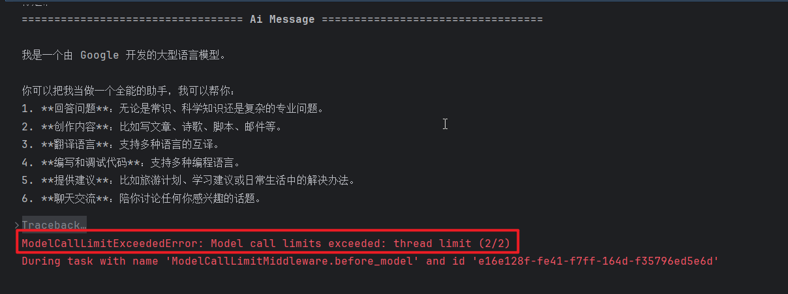


### 举例3：单次调用限制-优雅退出,比较复杂

### 例3 步骤1需要编写一个假的deepseek服务器：fake_deepseek_server.py，代码如下

```
"""
@Author:shkstart
@Desc: 
"""

import json
import random
import time
from http.server import BaseHTTPRequestHandler, HTTPServer


class FakeDeepSeekHandler(BaseHTTPRequestHandler):
    def do_POST(self):
        content_length = int(self.headers.get("Content-Length", 0))
        raw_body = self.rfile.read(content_length).decode("utf-8")

        print("\n" + "=" * 100)

        json_body = None
        try:
            json_body = json.loads(raw_body)
            print("[JSON BODY]")
            print(json.dumps(json_body, ensure_ascii=False, indent=2))
        except Exception as e:
            print("[JSON PARSE ERROR]")
            print(repr(e))

        response = {
            "id": "chatcmpl-test",
            "object": "chat.completion",
            "created": int(time.time()),
            "model": "any",
            "choices": [
                {
                    "index": 0,
                    "message": {
                        "role": "assistant",
                        "content": "",
                        "tool_calls": [
                            {
                                "id": "call_1",
                                "type": "function",
                                "function": {
                                    "name": json_body["tools"][0]["function"]["name"],
                                    "arguments": json.dumps(
                                        {'name': '康师傅', 'email': 'songhongkang@atguigu.cn', 'phone': '12345678912'},
                                        ensure_ascii=False
                                    )
                                }
                            }
                        ]
                    },
                    "finish_reason": "stop"
                }
            ],
            "usage": {
                "prompt_tokens": 1,
                "completion_tokens": 1,
                "total_tokens": 2
            }
        }
        append_val = {
            "id": "call_2",
            "type": "function",
            "function": {
                "name": json_body["tools"][1]["function"]["name"],
                "arguments": json.dumps(
                    {'event_name': '问数项目启动会', 'date': '2026-03-27'},
                    ensure_ascii=False
                )
            }
        }

        if random.randint(1, 10) > 2:
            response["choices"][0]["message"]["tool_calls"].append(append_val)
        # response["choices"][0]["message"]["tool_calls"][0]["function"]["arguments"] = json.dumps(
        #     {'name1': '康师傅', 'email2': 'songhongkang@atguigu.cn', 'phone': '12345678912'},
        #     ensure_ascii=False
        # )

        print("\n" + "=" * 100)
        print("[RESPONSE]")
        print(json.dumps(response, ensure_ascii=False, indent=2))

        body = json.dumps(response, ensure_ascii=False).encode("utf-8")

        self.send_response(200)
        self.send_header("Content-Type", "application/json; charset=utf-8")
        self.send_header("Content-Length", str(len(body)))
        self.end_headers()
        self.wfile.write(body)

    def log_message(self, format, *args):
        pass


def main():
    server = HTTPServer(("127.0.0.1", 8889), FakeDeepSeekHandler)
    print("Fake DeepSeek server running at http://127.0.0.1:8889")
    server.serve_forever()


if __name__ == "__main__":
    main()
```

### 例3 步骤2，客户端代码

```
from pydantic import BaseModel, Field
from langchain_core import messages
from langchain.agents.middleware import SummarizationMiddleware, PIIMiddleware, TodoListMiddleware
from langchain_core.messages import SystemMessage, HumanMessage, AIMessage
from langchain_core.tools import tool
from typing import Union, Dict, Any
from langchain_openai import ChatOpenAI
from langchain.agents import create_agent
from langgraph.config import get_stream_writer
from rich import print as rprint
from langchain.agents.middleware import ModelCallLimitMiddleware
from langgraph.checkpoint.memory import InMemorySaver


# 1.初始化模型给中间件使用，不是agent
model = ChatOpenAI(
    model="any", # 这个模型必须和fake_deepseek_server返回的模型名称一致
    api_key="sk12345",
    base_url="http://127.0.0.1:8889", # 必须是fake_deepseek_server提供的url
)
# 2,创建agent
class ContactInfo(BaseModel):
    """用户的联系方式"""
    name: str = Field(description="用户姓名")
    email: str = Field(description="用户邮箱地址")
    phone: str = Field(description="用户的手机号")


class EventInfo(BaseModel):
    event_name: str = Field(description="事件名称")
    date: str = Field(description="事件发生日期")

agent = create_agent(
    model=model,
    checkpointer=InMemorySaver(),
    middleware=[
        ModelCallLimitMiddleware(
            # thread_limit=2, # 每个线程最多2次模型调用
            run_limit=3, # 每次运行最多3次
            exit_behavior='end' # 抛异常
        ),
    ],
    response_format=Union[ContactInfo, EventInfo]

)

config = {"configurable":{"thread_id":"1"}} # 作用保证下面的代码都在同一个会话中

print("=" * 30, "> first <", "=" * 30)

first_resp = agent.invoke({"messages":[HumanMessage("你好")]},config=config)
for msg in first_resp["messages"]:
    msg.pretty_print()
print("=" * 30, "> second <", "=" * 30)
second_resp = agent.invoke({"messages":[HumanMessage("你是谁？")]},config=config)
for msg in second_resp["messages"]:
    msg.pretty_print()
print("=" * 30, "> third <", "=" * 30)
third_resp = agent.invoke({"messages":[HumanMessage("你是能帮我做什么？")]},config=config)
for msg in second_resp["messages"]:
    msg.pretty_print()
```

##### 注意：需要先把服务器运行起来。出现2个输出格式的概率是80%

#### agent的输出可能有20%的几率不一样

```
Deserializing unregistered type __main__.ContactInfo from checkpoint. This will be blocked in a future version. Set LANGGRAPH_STRICT_MSGPACK=true to block now, or add to allowed_msgpack_modules to allow explicitly: [('__main__', 'ContactInfo')]

============================== > first < ==============================
================================ Human Message =================================

你好
================================== Ai Message ==================================
Tool Calls:
  ContactInfo (call_1)
 Call ID: call_1
  Args:
    name: 康师傅
    email: songhongkang@atguigu.cn
    phone: 12345678912
  EventInfo (call_2)
 Call ID: call_2
  Args:
    event_name: 问数项目启动会
    date: 2026-03-27
================================= Tool Message =================================
Name: ContactInfo

Error: Model incorrectly returned multiple structured responses (ContactInfo, EventInfo) when only one is expected.
 Please fix your mistakes.
================================= Tool Message =================================
Name: EventInfo

Error: Model incorrectly returned multiple structured responses (ContactInfo, EventInfo) when only one is expected.
 Please fix your mistakes.
================================== Ai Message ==================================
Tool Calls:
  ContactInfo (call_1)
 Call ID: call_1
  Args:
    name: 康师傅
    email: songhongkang@atguigu.cn
    phone: 12345678912
  EventInfo (call_2)
 Call ID: call_2
  Args:
    event_name: 问数项目启动会
    date: 2026-03-27
================================= Tool Message =================================
Name: ContactInfo

Error: Model incorrectly returned multiple structured responses (ContactInfo, EventInfo) when only one is expected.
 Please fix your mistakes.
================================= Tool Message =================================
Name: EventInfo

Error: Model incorrectly returned multiple structured responses (ContactInfo, EventInfo) when only one is expected.
 Please fix your mistakes.
================================== Ai Message ==================================
Tool Calls:
  ContactInfo (call_1)
 Call ID: call_1
  Args:
    name: 康师傅
    email: songhongkang@atguigu.cn
    phone: 12345678912
================================= Tool Message =================================
Name: ContactInfo

Returning structured response: name='康师傅' email='songhongkang@atguigu.cn' phone='12345678912'
============================== > second < ==============================
================================ Human Message =================================

你好
================================== Ai Message ==================================
Tool Calls:
  ContactInfo (call_1)
 Call ID: call_1
  Args:
    name: 康师傅
    email: songhongkang@atguigu.cn
    phone: 12345678912
  EventInfo (call_2)
 Call ID: call_2
  Args:
    event_name: 问数项目启动会
    date: 2026-03-27
================================= Tool Message =================================
Name: ContactInfo

Error: Model incorrectly returned multiple structured responses (ContactInfo, EventInfo) when only one is expected.
 Please fix your mistakes.
================================= Tool Message =================================
Name: EventInfo

Error: Model incorrectly returned multiple structured responses (ContactInfo, EventInfo) when only one is expected.
 Please fix your mistakes.
================================== Ai Message ==================================
Tool Calls:
  ContactInfo (call_1)
 Call ID: call_1
  Args:
    name: 康师傅
    email: songhongkang@atguigu.cn
    phone: 12345678912
  EventInfo (call_2)
 Call ID: call_2
  Args:
    event_name: 问数项目启动会
    date: 2026-03-27
================================= Tool Message =================================
Name: ContactInfo

Error: Model incorrectly returned multiple structured responses (ContactInfo, EventInfo) when only one is expected.
 Please fix your mistakes.
================================= Tool Message =================================
Name: EventInfo

Error: Model incorrectly returned multiple structured responses (ContactInfo, EventInfo) when only one is expected.
 Please fix your mistakes.
================================== Ai Message ==================================
Tool Calls:
  ContactInfo (call_1)
 Call ID: call_1
  Args:
    name: 康师傅
    email: songhongkang@atguigu.cn
    phone: 12345678912
================================= Tool Message =================================
Name: ContactInfo

Returning structured response: name='康师傅' email='songhongkang@atguigu.cn' phone='12345678912'
================================ Human Message =================================

你是谁？
================================== Ai Message ==================================
Tool Calls:
  ContactInfo (call_1)
 Call ID: call_1
  Args:
    name: 康师傅
    email: songhongkang@atguigu.cn
    phone: 12345678912
  EventInfo (call_2)
 Call ID: call_2
  Args:
    event_name: 问数项目启动会
    date: 2026-03-27
================================= Tool Message =================================
Name: ContactInfo

Error: Model incorrectly returned multiple structured responses (ContactInfo, EventInfo) when only one is expected.
 Please fix your mistakes.
================================= Tool Message =================================
Name: EventInfo

Error: Model incorrectly returned multiple structured responses (ContactInfo, EventInfo) when only one is expected.
 Please fix your mistakes.
============================== > third < ==============================
================================ Human Message =================================

你好
================================== Ai Message ==================================
Tool Calls:
  ContactInfo (call_1)
 Call ID: call_1
  Args:
    name: 康师傅
    email: songhongkang@atguigu.cn
    phone: 12345678912
  EventInfo (call_2)
 Call ID: call_2
  Args:
    event_name: 问数项目启动会
    date: 2026-03-27
================================= Tool Message =================================
Name: ContactInfo

Error: Model incorrectly returned multiple structured responses (ContactInfo, EventInfo) when only one is expected.
 Please fix your mistakes.
================================= Tool Message =================================
Name: EventInfo

Error: Model incorrectly returned multiple structured responses (ContactInfo, EventInfo) when only one is expected.
 Please fix your mistakes.
================================== Ai Message ==================================
Tool Calls:
  ContactInfo (call_1)
 Call ID: call_1
  Args:
    name: 康师傅
    email: songhongkang@atguigu.cn
    phone: 12345678912
  EventInfo (call_2)
 Call ID: call_2
  Args:
    event_name: 问数项目启动会
    date: 2026-03-27
================================= Tool Message =================================
Name: ContactInfo

Error: Model incorrectly returned multiple structured responses (ContactInfo, EventInfo) when only one is expected.
 Please fix your mistakes.
================================= Tool Message =================================
Name: EventInfo

Error: Model incorrectly returned multiple structured responses (ContactInfo, EventInfo) when only one is expected.
 Please fix your mistakes.
================================== Ai Message ==================================
Tool Calls:
  ContactInfo (call_1)
 Call ID: call_1
  Args:
    name: 康师傅
    email: songhongkang@atguigu.cn
    phone: 12345678912
================================= Tool Message =================================
Name: ContactInfo

Returning structured response: name='康师傅' email='songhongkang@atguigu.cn' phone='12345678912'
================================ Human Message =================================

你是谁？
================================== Ai Message ==================================
Tool Calls:
  ContactInfo (call_1)
 Call ID: call_1
  Args:
    name: 康师傅
    email: songhongkang@atguigu.cn
    phone: 12345678912
  EventInfo (call_2)
 Call ID: call_2
  Args:
    event_name: 问数项目启动会
    date: 2026-03-27
================================= Tool Message =================================
Name: ContactInfo

Error: Model incorrectly returned multiple structured responses (ContactInfo, EventInfo) when only one is expected.
 Please fix your mistakes.
================================= Tool Message =================================
Name: EventInfo

Error: Model incorrectly returned multiple structured responses (ContactInfo, EventInfo) when only one is expected.
 Please fix your mistakes.

```


### 举例4：单次调用限制-抛异常

#### 例子4 步骤1和上面一样，

#### 例子4 步骤2.代码如下

```
from pydantic import BaseModel, Field
from langchain_core import messages
from langchain.agents.middleware import SummarizationMiddleware, PIIMiddleware, TodoListMiddleware
from langchain_core.messages import SystemMessage, HumanMessage, AIMessage
from langchain_core.tools import tool
from typing import Union, Dict, Any
from langchain_openai import ChatOpenAI
from langchain.agents import create_agent
from langgraph.config import get_stream_writer
from rich import print as rprint
from langchain.agents.middleware import ModelCallLimitMiddleware
from langgraph.checkpoint.memory import InMemorySaver


# 1.初始化模型给中间件使用，不是agent
model = ChatOpenAI(
    model="any", # 这个模型必须和fake_deepseek_server返回的模型名称一致
    api_key="sk12345",
    base_url="http://127.0.0.1:8889", # 必须是fake_deepseek_server提供的url
)
# 2,创建agent
class ContactInfo(BaseModel):
    """用户的联系方式"""
    name: str = Field(description="用户姓名")
    email: str = Field(description="用户邮箱地址")
    phone: str = Field(description="用户的手机号")


class EventInfo(BaseModel):
    event_name: str = Field(description="事件名称")
    date: str = Field(description="事件发生日期")

agent = create_agent(
    model=model,
    checkpointer=InMemorySaver(),
    middleware=[
        ModelCallLimitMiddleware(
            # thread_limit=2, # 每个线程最多2次模型调用
            run_limit=3, # 每次运行最多3次
            exit_behavior='error' # 抛异常
        ),
    ],
    response_format=Union[ContactInfo, EventInfo]

)

config = {"configurable":{"thread_id":"1"}} # 作用保证下面的代码都在同一个会话中

print("=" * 30, "> first <", "=" * 30)

first_resp = agent.invoke({"messages":[HumanMessage("你好")]},config=config)
for msg in first_resp["messages"]:
    msg.pretty_print()
print("=" * 30, "> second <", "=" * 30)
second_resp = agent.invoke({"messages":[HumanMessage("你是谁？")]},config=config)
for msg in second_resp["messages"]:
    msg.pretty_print()
print("=" * 30, "> third <", "=" * 30)
third_resp = agent.invoke({"messages":[HumanMessage("你是能帮我做什么？")]},config=config)
for msg in second_resp["messages"]:
    msg.pretty_print()
```

#### agent输出

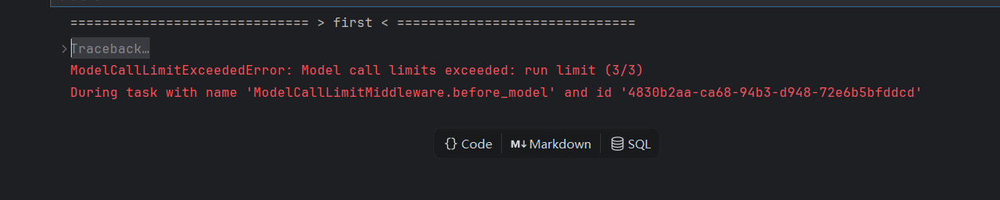

## 3.2ToolCallLimitedMiddleware中间件

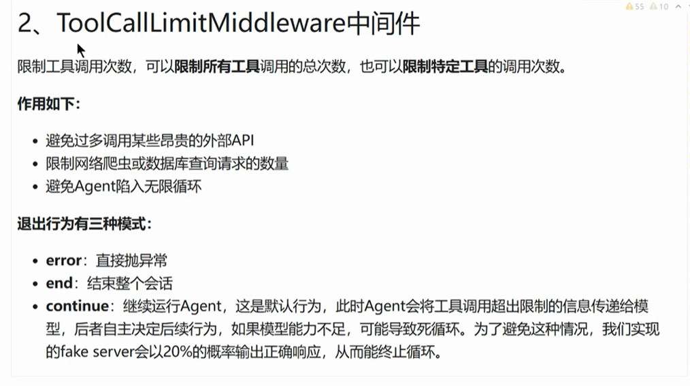

### 举例1：整个会话限制-优雅结束，还是需要那个fake_deep_seekserver

```
from pydantic import BaseModel, Field
from langchain_core import messages
from langchain.agents.middleware import SummarizationMiddleware, PIIMiddleware, TodoListMiddleware, \
    ToolCallLimitMiddleware
from langchain_core.messages import SystemMessage, HumanMessage, AIMessage
from langchain_core.tools import tool
from typing import Union, Dict, Any
from langchain_openai import ChatOpenAI
from langchain.agents import create_agent
from langgraph.config import get_stream_writer
from rich import print as rprint
from langchain.agents.middleware import ModelCallLimitMiddleware
from langgraph.checkpoint.memory import InMemorySaver


# 1.初始化模型给中间件使用，不是agent
model = ChatOpenAI(
    model="any", # 这个模型必须和fake_deepseek_server返回的模型名称一致
    api_key="sk12345",
    base_url="http://127.0.0.1:8889", # 必须是fake_deepseek_server提供的url
)

# 定义输出格式的结构
class ContactInfo(BaseModel):
    """用户的联系方式"""
    name: str = Field(description="用户姓名")
    email: str = Field(description="用户邮箱地址")
    phone: str = Field(description="用户的手机号")


class EventInfo(BaseModel):
    event_name: str = Field(description="事件名称")
    date: str = Field(description="事件发生日期")

agent = create_agent(
    model=model,
    checkpointer=InMemorySaver(),
    middleware=[
        ToolCallLimitMiddleware(
            thread_limit=2,
            # run_limit=2,
            exit_behavior='end'
        ),
    ],
    response_format=Union[ContactInfo,EventInfo],
)

config = {"configurable":{"thread_id":"1"}}

resp = agent.invoke({"messages":[
   HumanMessage(content="你好")
]},config=config)

for msg in resp["messages"]:
    msg.pretty_print()

```

#### agent输出

```
================================ Human Message =================================

你好
================================== Ai Message ==================================
Tool Calls:
  ContactInfo (call_1)
 Call ID: call_1
  Args:
    name: 康师傅
    email: songhongkang@atguigu.cn
    phone: 12345678912
  EventInfo (call_2)
 Call ID: call_2
  Args:
    event_name: 问数项目启动会
    date: 2026-03-27
================================= Tool Message =================================
Name: ContactInfo

Error: Model incorrectly returned multiple structured responses (ContactInfo, EventInfo) when only one is expected.
 Please fix your mistakes.
================================= Tool Message =================================
Name: EventInfo

Error: Model incorrectly returned multiple structured responses (ContactInfo, EventInfo) when only one is expected.
 Please fix your mistakes.
================================== Ai Message ==================================
Tool Calls:
  ContactInfo (call_1)
 Call ID: call_1
  Args:
    name: 康师傅
    email: songhongkang@atguigu.cn
    phone: 12345678912
  EventInfo (call_2)
 Call ID: call_2
  Args:
    event_name: 问数项目启动会
    date: 2026-03-27
================================= Tool Message =================================
Name: ContactInfo

Error: Model incorrectly returned multiple structured responses (ContactInfo, EventInfo) when only one is expected.
 Please fix your mistakes.
================================= Tool Message =================================
Name: EventInfo

Error: Model incorrectly returned multiple structured responses (ContactInfo, EventInfo) when only one is expected.
 Please fix your mistakes.
================================= Tool Message =================================
Name: ContactInfo

Tool call limit exceeded. Do not make additional tool calls.
================================= Tool Message =================================
Name: EventInfo

Tool call limit exceeded. Do not make additional tool calls.
================================== Ai Message ==================================

Tool call limit reached: thread limit exceeded (4/2 calls) and run limit exceeded (4/2 calls).

```


### 举例2：整个会话限制-抛异常,fake_deepseek_server必须启动而且工作正常

```
from pydantic import BaseModel, Field
from langchain_core import messages
from langchain.agents.middleware import SummarizationMiddleware, PIIMiddleware, TodoListMiddleware, \
    ToolCallLimitMiddleware
from langchain_core.messages import SystemMessage, HumanMessage, AIMessage
from langchain_core.tools import tool
from typing import Union, Dict, Any
from langchain_openai import ChatOpenAI
from langchain.agents import create_agent
from langgraph.config import get_stream_writer
from rich import print as rprint
from langchain.agents.middleware import ModelCallLimitMiddleware
from langgraph.checkpoint.memory import InMemorySaver


# 1.初始化模型给中间件使用，不是agent
model = ChatOpenAI(
    model="any", # 这个模型必须和fake_deepseek_server返回的模型名称一致
    api_key="sk12345",
    base_url="http://127.0.0.1:8889", # 必须是fake_deepseek_server提供的url
)

# 定义输出格式的结构
class ContactInfo(BaseModel):
    """用户的联系方式"""
    name: str = Field(description="用户姓名")
    email: str = Field(description="用户邮箱地址")
    phone: str = Field(description="用户的手机号")


class EventInfo(BaseModel):
    event_name: str = Field(description="事件名称")
    date: str = Field(description="事件发生日期")

agent = create_agent(
    model=model,
    checkpointer=InMemorySaver(),
    middleware=[
        ToolCallLimitMiddleware(
            thread_limit=2,
            # run_limit=2,
            exit_behavior='error'
        ),
    ],
    response_format=Union[ContactInfo,EventInfo],
)

config = {"configurable":{"thread_id":"1"}}

resp = agent.invoke({"messages":[
   HumanMessage(content="你好")
]},config=config)

for msg in resp["messages"]:
    msg.pretty_print()

```

#### agent输出

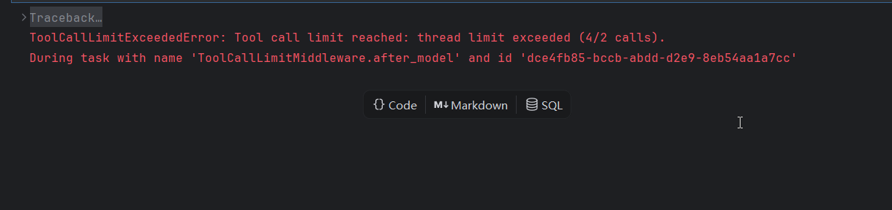

### 举例3：单次调用限制-继续运行，exit_behavior='continue'，,fake_deepseek_server必须启动而且工作正常

```
from pydantic import BaseModel, Field
from langchain_core import messages
from langchain.agents.middleware import SummarizationMiddleware, PIIMiddleware, TodoListMiddleware, \
    ToolCallLimitMiddleware
from langchain_core.messages import SystemMessage, HumanMessage, AIMessage
from langchain_core.tools import tool
from typing import Union, Dict, Any
from langchain_openai import ChatOpenAI
from langchain.agents import create_agent
from langgraph.config import get_stream_writer
from rich import print as rprint
from langchain.agents.middleware import ModelCallLimitMiddleware
from langgraph.checkpoint.memory import InMemorySaver


# 1.初始化模型给中间件使用，不是agent
model = ChatOpenAI(
    model="any", # 这个模型必须和fake_deepseek_server返回的模型名称一致
    api_key="sk12345",
    base_url="http://127.0.0.1:8889", # 必须是fake_deepseek_server提供的url
)

# 定义输出格式的结构
class ContactInfo(BaseModel):
    """用户的联系方式"""
    name: str = Field(description="用户姓名")
    email: str = Field(description="用户邮箱地址")
    phone: str = Field(description="用户的手机号")


class EventInfo(BaseModel):
    event_name: str = Field(description="事件名称")
    date: str = Field(description="事件发生日期")

agent = create_agent(
    model=model,
    checkpointer=InMemorySaver(),
    middleware=[
        ToolCallLimitMiddleware(
            # thread_limit=2,
            run_limit=2,
            exit_behavior='continue'
        ),
    ],
    response_format=Union[ContactInfo,EventInfo],
)

config = {"configurable":{"thread_id":"1"}}

resp = agent.invoke({"messages":[
   HumanMessage(content="你好")
]},config=config)

for msg in resp["messages"]:
    msg.pretty_print()

```

#### agent输出

```
================================ Human Message =================================

你好
================================== Ai Message ==================================
Tool Calls:
  ContactInfo (call_1)
 Call ID: call_1
  Args:
    name: 康师傅
    email: songhongkang@atguigu.cn
    phone: 12345678912
  EventInfo (call_2)
 Call ID: call_2
  Args:
    event_name: 问数项目启动会
    date: 2026-03-27
================================= Tool Message =================================
Name: ContactInfo

Error: Model incorrectly returned multiple structured responses (ContactInfo, EventInfo) when only one is expected.
 Please fix your mistakes.
================================= Tool Message =================================
Name: EventInfo

Error: Model incorrectly returned multiple structured responses (ContactInfo, EventInfo) when only one is expected.
 Please fix your mistakes.
================================== Ai Message ==================================
Tool Calls:
  ContactInfo (call_1)
 Call ID: call_1
  Args:
    name: 康师傅
    email: songhongkang@atguigu.cn
    phone: 12345678912
  EventInfo (call_2)
 Call ID: call_2
  Args:
    event_name: 问数项目启动会
    date: 2026-03-27
================================= Tool Message =================================
Name: ContactInfo

Error: Model incorrectly returned multiple structured responses (ContactInfo, EventInfo) when only one is expected.
 Please fix your mistakes.
================================= Tool Message =================================
Name: EventInfo

Error: Model incorrectly returned multiple structured responses (ContactInfo, EventInfo) when only one is expected.
 Please fix your mistakes.
================================= Tool Message =================================
Name: ContactInfo

Tool call limit exceeded. Do not make additional tool calls.
================================= Tool Message =================================
Name: EventInfo

Tool call limit exceeded. Do not make additional tool calls.
================================== Ai Message ==================================
Tool Calls:
  ContactInfo (call_1)
 Call ID: call_1
  Args:
    name: 康师傅
    email: songhongkang@atguigu.cn
    phone: 12345678912
  EventInfo (call_2)
 Call ID: call_2
  Args:
    event_name: 问数项目启动会
    date: 2026-03-27
================================= Tool Message =================================
Name: ContactInfo

Error: Model incorrectly returned multiple structured responses (ContactInfo, EventInfo) when only one is expected.
 Please fix your mistakes.
================================= Tool Message =================================
Name: EventInfo

Error: Model incorrectly returned multiple structured responses (ContactInfo, EventInfo) when only one is expected.
 Please fix your mistakes.
================================= Tool Message =================================
Name: ContactInfo

Tool call limit exceeded. Do not make additional tool calls.
================================= Tool Message =================================
Name: EventInfo

Tool call limit exceeded. Do not make additional tool calls.
================================== Ai Message ==================================
Tool Calls:
  ContactInfo (call_1)
 Call ID: call_1
  Args:
    name: 康师傅
    email: songhongkang@atguigu.cn
    phone: 12345678912
================================= Tool Message =================================
Name: ContactInfo

Returning structured response: name='康师傅' email='songhongkang@atguigu.cn' phone='12345678912'
================================= Tool Message =================================
Name: ContactInfo

Tool call limit exceeded. Do not make additional tool calls.

```


## 3.3ModelCallbackMiddleware中间件

### 拥有故障转移，当主模型无法访问是，使用备用模型

### 举例代码

```
from langchain.agents.middleware import SummarizationMiddleware, PIIMiddleware, TodoListMiddleware, \
    ModelFallbackMiddleware
from langchain_core.messages import SystemMessage, HumanMessage, AIMessage
from langchain.agents import create_agent
from langgraph.config import get_stream_writer
from rich import print as rprint


## 2.创建agent
agent = create_agent(
    model="ollama:fake_qwen",
    middleware=[
        ModelFallbackMiddleware(
            "ollama:483025889/qwen3.5:9b",
            "ollama:mistral-nemo:latest"
        )
    ]
)

resp = agent.invoke({"messages": [HumanMessage("你是谁？")]})
last_res = resp["messages"][-1]
rprint(last_res)
print('=' * 30, '-> model_name <-', '=' * 30)
print(last_res.response_metadata.get("model_name"))

```


#### agent输出

```
AIMessage(
    content='你好！我是 
Qwen3.5，是通义实验室研发的超大规模语言模型。我具备强大的语言理解、逻辑推理、代码生成及多轮对话能力，可以帮助你完成
文本创作、问题解答、数据分析等任务。无论你需要什么帮助，都可以随时问我哦～有什么具体问题想聊聊吗？ 😊',
    additional_kwargs={},
    response_metadata={
        'model': '483025889/qwen3.5:9b',
        'created_at': '2026-10-21T01:43:33.5540086Z',
        'done': True,
        'done_reason': 'stop',
        'total_duration': 55133910100,
        'load_duration': 7720100,
        'prompt_eval_count': 12,
        'prompt_eval_duration': 374868000,
        'eval_count': 233,
        'eval_duration': 54702719000,
        'logprobs': None,
        'model_name': '483025889/qwen3.5:9b',
        'model_provider': 'ollama'
    },
    id='lc_run--01a15c1f-ec53-7522-97f7-d9b5a14d21fb-0',
    tool_calls=[],
    invalid_tool_calls=[],
    usage_metadata={'input_tokens': 12, 'output_tokens': 233, 'total_tokens': 245}
)
```

============================== -> model_name <- ==============================
483025889/qwen3.5:9b

## 3.4 LLMToolSelectorMiddleware中间件

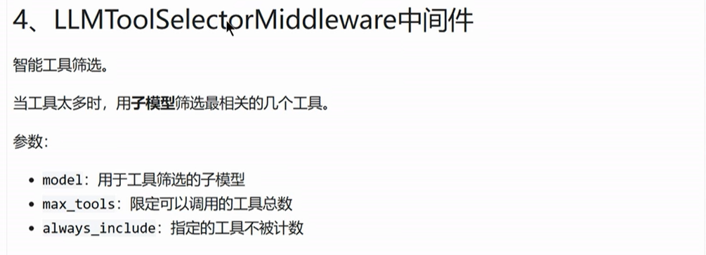

### 举例1,代码如下

```

from langchain_core import messages
from langchain.agents.middleware import SummarizationMiddleware, LLMToolSelectorMiddleware
from langchain_core.messages import SystemMessage, HumanMessage, AIMessage
from langchain_core.tools import tool
from typing import Union, Dict, Any
from langchain_openai import ChatOpenAI
from langchain.agents import create_agent
from langgraph.config import get_stream_writer
from rich import print as rprint
from utils.tool_utils import query_weather_from_web,query_news_from_web

# 1.初始化模型需要2个模型应该是model_out直接给agent使用，另外应该model_in,防止中间件里面
model_out = ChatOpenAI(
    model="qwen3-vl:latest",
    # model="483025889/qwen3.5:9b",
    # model="gemma4:12b",
    api_key="sk12345",
    base_url="http://localhost:11434/v1",
)

model_in = ChatOpenAI(
    # model="qwen3-vl:latest",
    model="483025889/qwen3.5:9b",
    # model="gemma4:12b",
    api_key="sk12345",
    base_url="http://localhost:11434/v1",
)

## 定义工具
@tool
def get_weather(city: str):
    """查询指定城市天气"""
    return f"{city}今天天气晴朗"


@tool
def get_news():
    """查询今日国内新闻概要"""
    return ("今日国内新闻概要："
            "中方三艘油轮过航霍尔木兹海峡")


@tool
def calculate(num1: int, num2: int) -> int:
    """
    执行数学计算

    Args:
        num1: 第一个加数
        num2: 第二个加数
    """
    return num1 + num2

@tool
def search_stock(symbol: str):
    """
    查询股票行情

    Args:
        symbol: 股票代码
    """
    return "该股票今天行情不错"

agent = create_agent(
    model=model_out,
    tools=[get_weather, get_news, calculate, search_stock],
    middleware=[
        LLMToolSelectorMiddleware(
            model=model_in,
            max_tools=0,
            always_include=["get_weather"]
        )
    ]
)

resp = agent.invoke({"messages":[HumanMessage("北京今天天气如何？今日新闻概要")]})
for msg in resp["messages"]:
    msg.pretty_print()
```


#### agent输出

```
================================ Human Message =================================

北京今天天气如何？今日新闻概要
================================== Ai Message ==================================
Tool Calls:
  get_weather (call_bsdjtvrd)
 Call ID: call_bsdjtvrd
  Args:
    city: 北京
================================= Tool Message =================================
Name: get_weather

北京今天天气晴朗
================================== Ai Message ==================================

北京今天天气晴朗。关于今日新闻概要，我目前无法提供实时新闻内容（当前工具仅支持天气查询功能）。需要我为您查询其他信息吗？

```


### 举例2,代码如下

```

from langchain_core import messages
from langchain.agents.middleware import SummarizationMiddleware, LLMToolSelectorMiddleware
from langchain_core.messages import SystemMessage, HumanMessage, AIMessage
from langchain_core.tools import tool
from typing import Union, Dict, Any
from langchain_openai import ChatOpenAI
from langchain.agents import create_agent
from langgraph.config import get_stream_writer
from rich import print as rprint
from utils.tool_utils import query_weather_from_web,query_news_from_web

# 1.初始化模型需要2个模型应该是model_out直接给agent使用，另外应该model_in,防止中间件里面
model_out = ChatOpenAI(
    model="qwen3-vl:latest",
    # model="483025889/qwen3.5:9b",
    # model="gemma4:12b",
    api_key="sk12345",
    base_url="http://localhost:11434/v1",
)

model_in = ChatOpenAI(
    # model="qwen3-vl:latest",
    model="483025889/qwen3.5:9b",
    # model="gemma4:12b",
    api_key="sk12345",
    base_url="http://localhost:11434/v1",
)

## 定义工具
@tool
def get_weather(city: str):
    """查询指定城市天气"""
    return f"{city}今天天气晴朗"


@tool
def get_news():
    """查询今日国内新闻概要"""
    return ("今日国内新闻概要："
            "中方三艘油轮过航霍尔木兹海峡")


@tool
def calculate(num1: int, num2: int) -> int:
    """
    执行数学计算

    Args:
        num1: 第一个加数
        num2: 第二个加数
    """
    return num1 + num2

@tool
def search_stock(symbol: str):
    """
    查询股票行情

    Args:
        symbol: 股票代码
    """
    return "该股票今天行情不错"

agent = create_agent(
    model=model_out,
    tools=[get_weather, get_news, calculate, search_stock],
    middleware=[
        LLMToolSelectorMiddleware(
            model=model_in,
            max_tools=0,
            always_include=["get_news"]
        )
    ]
)

resp = agent.invoke({"messages":[HumanMessage("北京今天天气如何？今日新闻概要")]})
for msg in resp["messages"]:
    msg.pretty_print()
```

#### agent输出

```
================================ Human Message =================================

北京今天天气如何？今日新闻概要
================================== Ai Message ==================================
Tool Calls:
  get_news (call_1igymmj6)
 Call ID: call_1igymmj6
  Args:
================================= Tool Message =================================
Name: get_news

今日国内新闻概要：中方三艘油轮过航霍尔木兹海峡
================================== Ai Message ==================================

关于北京今日天气，当前工具无法提供天气查询功能。已为您获取今日国内新闻概要：
【今日国内新闻概要】中方三艘油轮过航霍尔木兹海峡

如需其他帮助，请随时告知。

```


### 举例3,代码如下

```

from langchain_core import messages
from langchain.agents.middleware import SummarizationMiddleware, LLMToolSelectorMiddleware
from langchain_core.messages import SystemMessage, HumanMessage, AIMessage
from langchain_core.tools import tool
from typing import Union, Dict, Any
from langchain_openai import ChatOpenAI
from langchain.agents import create_agent
from langgraph.config import get_stream_writer
from rich import print as rprint
from utils.tool_utils import query_weather_from_web,query_news_from_web

# 1.初始化模型需要2个模型应该是model_out直接给agent使用，另外应该model_in,防止中间件里面
model_out = ChatOpenAI(
    model="qwen3-vl:latest",
    # model="483025889/qwen3.5:9b",
    # model="gemma4:12b",
    api_key="sk12345",
    base_url="http://localhost:11434/v1",
)

model_in = ChatOpenAI(
    # model="qwen3-vl:latest",
    model="483025889/qwen3.5:9b",
    # model="gemma4:12b",
    api_key="sk12345",
    base_url="http://localhost:11434/v1",
)

## 定义工具
@tool
def get_weather(city: str):
    """查询指定城市天气"""
    return f"{city}今天天气晴朗"


@tool
def get_news():
    """查询今日国内新闻概要"""
    return ("今日国内新闻概要："
            "中方三艘油轮过航霍尔木兹海峡")


@tool
def calculate(num1: int, num2: int) -> int:
    """
    执行数学计算

    Args:
        num1: 第一个加数
        num2: 第二个加数
    """
    return num1 + num2

@tool
def search_stock(symbol: str):
    """
    查询股票行情

    Args:
        symbol: 股票代码
    """
    return "该股票今天行情不错"

agent = create_agent(
    model=model_out,
    tools=[get_weather, get_news, calculate, search_stock],
    middleware=[
        LLMToolSelectorMiddleware(
            model=model_in,
            max_tools=0,
            always_include=["get_news","get_weather"]
        )
    ]
)

resp = agent.invoke({"messages":[HumanMessage("北京今天天气如何？今日新闻概要")]})
for msg in resp["messages"]:
    msg.pretty_print()
```

#### agent输出

```
================================ Human Message =================================

北京今天天气如何？今日新闻概要
================================== Ai Message ==================================
Tool Calls:
  get_weather (call_bsat1cmw)
 Call ID: call_bsat1cmw
  Args:
    city: 北京
  get_news (call_fdhusdsy)
 Call ID: call_fdhusdsy
  Args:
================================= Tool Message =================================
Name: get_weather

北京今天天气晴朗
================================= Tool Message =================================
Name: get_news

今日国内新闻概要：中方三艘油轮过航霍尔木兹海峡
================================== Ai Message ==================================

北京今日天气晴朗，适合外出活动~  
今日国内新闻概要：中方三艘油轮过航霍尔木兹海峡。

```


### 举例4,代码如下

```

from langchain_core import messages
from langchain.agents.middleware import SummarizationMiddleware, LLMToolSelectorMiddleware
from langchain_core.messages import SystemMessage, HumanMessage, AIMessage
from langchain_core.tools import tool
from typing import Union, Dict, Any
from langchain_openai import ChatOpenAI
from langchain.agents import create_agent
from langgraph.config import get_stream_writer
from rich import print as rprint
from utils.tool_utils import query_weather_from_web,query_news_from_web

# 1.初始化模型需要2个模型应该是model_out直接给agent使用，另外应该model_in,防止中间件里面
model_out = ChatOpenAI(
    # model="qwen3-vl:latest",
    # model="483025889/qwen3.5:9b", # 在这里不好，不会灵活适配工具
    model="gemma4:12b", # 在这里ok
    api_key="sk12345",
    base_url="http://localhost:11434/v1",
)

model_in = ChatOpenAI(
    model="qwen3-vl:latest",
    # model="483025889/qwen3.5:9b",
    # model="gemma4:12b",
    api_key="sk12345",
    base_url="http://localhost:11434/v1",
)

## 定义工具
@tool
def get_weather(city: str):
    """查询指定城市天气"""
    return f"{city}今天天气晴朗"


@tool
def get_news():
    """查询今日国内新闻概要"""
    return ("今日国内新闻概要："
            "中方三艘油轮过航霍尔木兹海峡")


@tool
def calculate(num1: int, num2: int) -> int:
    """
    执行数学计算

    Args:
        num1: 第一个加数
        num2: 第二个加数
    """
    return num1 + num2

@tool
def search_stock(symbol: str):
    """
    查询股票行情

    Args:
        symbol: 股票代码
    """
    return "该股票今天行情不错"

agent = create_agent(
    model=model_out,
    tools=[get_weather, get_news, calculate, search_stock],
    middleware=[
        LLMToolSelectorMiddleware(
            model=model_in,
            max_tools=1,
            always_include=["get_weather"]
        )
    ]
)

resp = agent.invoke({"messages":[HumanMessage("北京今天天气如何？今日新闻概要")]})
for msg in resp["messages"]:
    msg.pretty_print()
```

#### agent输出

```
================================ Human Message =================================

北京今天天气如何？今日新闻概要
================================== Ai Message ==================================
Tool Calls:
  get_weather (call_vi834fcp)
 Call ID: call_vi834fcp
  Args:
    city: 北京
================================= Tool Message =================================
Name: get_weather

北京今天天气晴朗
================================== Ai Message ==================================
Tool Calls:
  get_news (call_pumdc4b8)
 Call ID: call_pumdc4b8
  Args:
================================= Tool Message =================================
Name: get_news

今日国内新闻概要：中方三艘油轮过航霍尔木兹海峡
================================== Ai Message ==================================

北京今天天气晴朗。

今日新闻概要：中方三艘油轮过航霍尔木兹海峡。

```

### 大模型要切换着用，不能一直使用同一个模型，有时候有幻觉。

### 举例5,代码如下

```

from langchain_core import messages
from langchain.agents.middleware import SummarizationMiddleware, LLMToolSelectorMiddleware
from langchain_core.messages import SystemMessage, HumanMessage, AIMessage
from langchain_core.tools import tool
from typing import Union, Dict, Any
from langchain_openai import ChatOpenAI
from langchain.agents import create_agent
from langgraph.config import get_stream_writer
from rich import print as rprint
from utils.tool_utils import query_weather_from_web,query_news_from_web

# 1.初始化模型需要2个模型应该是model_out直接给agent使用，另外应该model_in,防止中间件里面
model_out = ChatOpenAI(
    # model="qwen3-vl:latest", # 这里不好用
    # model="483025889/qwen3.5:9b", #这里不好用
    model="gemma4:12b",
    api_key="sk12345",
    base_url="http://localhost:11434/v1",
)

model_in = ChatOpenAI(
    # model="qwen3-vl:latest",
    model="483025889/qwen3.5:9b",
    # model="gemma4:12b",
    api_key="sk12345",
    base_url="http://localhost:11434/v1",
)

## 定义工具
@tool
def get_weather(city: str):
    """查询指定城市天气"""
    return f"{city}今天天气晴朗"


@tool
def get_news():
    """查询今日国内新闻概要"""
    return ("今日国内新闻概要："
            "中方三艘油轮过航霍尔木兹海峡")


@tool
def calculate(num1: int, num2: int) -> int:
    """
    执行数学计算

    Args:
        num1: 第一个加数
        num2: 第二个加数
    """
    return num1 + num2

@tool
def search_stock(symbol: str):
    """
    查询股票行情

    Args:
        symbol: 股票代码
    """
    return "该股票今天行情不错"

agent = create_agent(
    model=model_out,
    tools=[get_weather, get_news, calculate, search_stock],
    middleware=[
        LLMToolSelectorMiddleware(
            model=model_in,
            max_tools=1,
            always_include=["get_news"]
        )
    ]
)

resp = agent.invoke({"messages":[HumanMessage("北京今天天气如何？今日新闻概要")]})
for msg in resp["messages"]:
    msg.pretty_print()
```

#### agent输出

```
================================ Human Message =================================

北京今天天气如何？今日新闻概要
================================== Ai Message ==================================
Tool Calls:
  get_weather (call_jav3kc07)
 Call ID: call_jav3kc07
  Args:
    city: 北京
================================= Tool Message =================================
Name: get_weather

北京今天天气晴朗
================================== Ai Message ==================================
Tool Calls:
  get_news (call_pvx5agw0)
 Call ID: call_pvx5agw0
  Args:
================================= Tool Message =================================
Name: get_news

今日国内新闻概要：中方三艘油轮过航霍尔木兹海峡
================================== Ai Message ==================================

北京今天天气晴朗。

今日国内新闻概要：中方三艘油轮过航霍尔木兹海峡。

```


## 3.5 ToolRetryMiddleware中间件

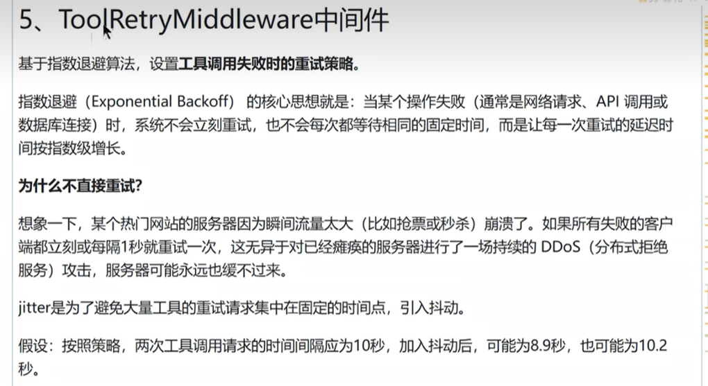

### 举例1：带抖动,jitter=True

```
from datetime import time, datetime

from langchain_core import messages
from langchain.agents.middleware import SummarizationMiddleware, LLMToolSelectorMiddleware, ToolRetryMiddleware
from langchain_core.messages import SystemMessage, HumanMessage, AIMessage
from langchain_core.tools import tool
from typing import Union, Dict, Any
from langchain_openai import ChatOpenAI
from langchain.agents import create_agent
from langgraph.config import get_stream_writer
from rich import print as rprint
from utils.tool_utils import query_weather_from_web,query_news_from_web

# 1.初始化模型
model= ChatOpenAI(
    model="qwen3-vl:latest",
    # model="483025889/qwen3.5:9b",
    # model="gemma4:12b",
    api_key="sk12345",
    base_url="http://localhost:11434/v1",
)

# 2定义函数
def write_time(s:str):
    with open("call_times_with_jitter.txt",'a',encoding='utf-8') as f:
        f.write(s+'\n')

count = 1
start_time = None
# 3.定义工具
@tool
def get_weather(city:str):
    """查询指定城市天气"""
    global count
    global start_time
    interval = 0
    curr_time = datetime.now()
    if start_time is None:
        interval = 0
    else:
         # 计算当前调用与上一次调用之间的时间差（秒）
        interval = (curr_time - start_time).total_seconds()
    start_time = curr_time
    res_str = f"第 {count} 次调用，当前时间： {start_time}, 和上次调用间隔 {interval} 秒"
    count+=1
    # 写日志
    write_time(res_str)
     # 故意抛出 TimeoutError，以此触发中间件的重试机制
    raise TimeoutError("Not Implemented")

agent = create_agent(
    model=model,
    tools=[get_weather],
    middleware=[
        ToolRetryMiddleware(
            max_retries=6,# 最大重试次数（不包含初始的那次调用，一共最多调 1 + 6 = 7 次）
            backoff_factor=2.0,# 指数退避因子（每次重试等待时间乘以 2）
            initial_delay=1.0, # 第一次重试前的初始等待时间（1 秒）
            max_delay=10.0, # 最大等待延迟上限（防止指数增长无限大，限制在 10 秒）
            jitter=True, # 开启抖动（在等待时间中加入随机性，防止并发请求时出现“惊群效应”）
            retry_on=(TimeoutError,),# 仅针对捕获到特定的 TimeoutError 异常时才触发重试
            on_failure="continue" # 当达到最大重试次数依然失败时，Agent 的行为："continue" 表示将错误信息包装后塞回对话历史，让大模型知道失败了并继续决策
        )
    ]
)

resp = agent.invoke({"messages":[HumanMessage("北京今天的天气如何？")]})

for msg in resp["messages"]:
    msg.pretty_print()


```


#### agent输出：

```
================================ Human Message =================================

北京今天的天气如何？
================================== Ai Message ==================================
Tool Calls:
  get_weather (call_9ydhsowe)
 Call ID: call_9ydhsowe
  Args:
    city: 北京
================================= Tool Message =================================
Name: get_weather

Tool 'get_weather' failed after 7 attempts with TimeoutError: Not Implemented. Please try again.
================================== Ai Message ==================================

很抱歉，目前无法获取北京的天气信息，系统出现了技术故障（TimeoutError）。建议稍后再尝试查询，或检查网络连接是否正常。如果您有其他需求，我很乐意为您提供帮助。

```

#### call_times_with_jitter.txt的内容

```
第 1 次调用，当前时间： 2026-10-21 18:25:52.599075, 和上次调用间隔 0 秒 
第 2 次调用，当前时间： 2026-10-21 18:25:53.944064, 和上次调用间隔 1.344989 秒 
第 3 次调用，当前时间： 2026-10-21 18:25:56.375922, 和上次调用间隔 2.431858 秒 
第 4 次调用，当前时间： 2026-10-21 18:26:00.375263, 和上次调用间隔 3.999341 秒 
第 5 次调用，当前时间： 2026-10-21 18:26:07.924225, 和上次调用间隔 7.548962 秒 
第 6 次调用，当前时间： 2026-10-21 18:26:19.185732, 和上次调用间隔 11.261507 秒 
第 7 次调用，当前时间： 2026-10-21 18:26:27.930162, 和上次调用间隔 8.74443 秒 
```


### 举例2：无抖动,jitter=False

```
from datetime import time, datetime

from langchain_core import messages
from langchain.agents.middleware import SummarizationMiddleware, LLMToolSelectorMiddleware, ToolRetryMiddleware
from langchain_core.messages import SystemMessage, HumanMessage, AIMessage
from langchain_core.tools import tool
from typing import Union, Dict, Any
from langchain_openai import ChatOpenAI
from langchain.agents import create_agent
from langgraph.config import get_stream_writer
from rich import print as rprint
from utils.tool_utils import query_weather_from_web,query_news_from_web

# 1.初始化模型
model= ChatOpenAI(
    model="qwen3-vl:latest",
    # model="483025889/qwen3.5:9b",
    # model="gemma4:12b",
    api_key="sk12345",
    base_url="http://localhost:11434/v1",
)

# 2定义函数
def write_time(s:str):
    with open("call_times_with_jitter.txt",'a',encoding='utf-8') as f:
        f.write(s+'\n')

count = 1
start_time = None
# 3.定义工具
@tool
def get_weather(city:str):
    """查询指定城市天气"""
    global count
    global start_time
    interval = 0
    curr_time = datetime.now()
    if start_time is None:
        interval = 0
    else:
         # 计算当前调用与上一次调用之间的时间差（秒）
        interval = (curr_time - start_time).total_seconds()
    start_time = curr_time
    res_str = f"第 {count} 次调用，当前时间： {start_time}, 和上次调用间隔 {interval} 秒"
    count+=1
    # 写日志
    write_time(res_str)
     # 故意抛出 TimeoutError，以此触发中间件的重试机制
    raise TimeoutError("Not Implemented")

agent = create_agent(
    model=model,
    tools=[get_weather],
    middleware=[
        ToolRetryMiddleware(
            max_retries=6,# 最大重试次数（不包含初始的那次调用，一共最多调 1 + 6 = 7 次）
            backoff_factor=2.0,# 指数退避因子（每次重试等待时间乘以 2）
            initial_delay=1.0, # 第一次重试前的初始等待时间（1 秒）
            max_delay=10.0, # 最大等待延迟上限（防止指数增长无限大，限制在 10 秒）
            jitter=False, # 关闭抖动，意味着重试机制从“随机化的指数退避”退化成了“严格固定的指数退避
            retry_on=(TimeoutError,),# 仅针对捕获到特定的 TimeoutError 异常时才触发重试
            on_failure="continue" # 当达到最大重试次数依然失败时，Agent 的行为："continue" 表示将错误信息包装后塞回对话历史，让大模型知道失败了并继续决策
        )
    ]
)

resp = agent.invoke({"messages":[HumanMessage("北京今天的天气如何？")]})

# 1. 你的提问 -> 2. AI 决定调用工具 -> 3. 重试失败后的错误反馈 -> 4. AI 最终给出的兜底回复
for msg in resp["messages"]:
    msg.pretty_print()


```

#### agent输出：

```
================================ Human Message =================================

北京今天的天气如何？
================================== Ai Message ==================================
Tool Calls:
  get_weather (call_qkkbxxzh)
 Call ID: call_qkkbxxzh
  Args:
    city: 北京
================================= Tool Message =================================
Name: get_weather

Tool 'get_weather' failed after 7 attempts with TimeoutError: Not Implemented. Please try again.
================================== Ai Message ==================================

很抱歉，当前无法获取北京的天气信息。可能是服务暂时不可用，建议您稍后再尝试查询，或通过其他天气应用获取实时数据。

```

#### call_times_with_jitter.txt的内容

```
第 1 次调用，当前时间： 2026-10-21 18:25:52.599075, 和上次调用间隔 0 秒   # 带抖动
第 2 次调用，当前时间： 2026-10-21 18:25:53.944064, 和上次调用间隔 1.344989 秒 
第 3 次调用，当前时间： 2026-10-21 18:25:56.375922, 和上次调用间隔 2.431858 秒 
第 4 次调用，当前时间： 2026-10-21 18:26:00.375263, 和上次调用间隔 3.999341 秒 
第 5 次调用，当前时间： 2026-10-21 18:26:07.924225, 和上次调用间隔 7.548962 秒 
第 6 次调用，当前时间： 2026-10-21 18:26:19.185732, 和上次调用间隔 11.261507 秒 
第 7 次调用，当前时间： 2026-10-21 18:26:27.930162, 和上次调用间隔 8.74443 秒 
第 1 次调用，当前时间： 2026-10-21 18:35:59.178381, 和上次调用间隔 0 秒  # 无抖动
第 2 次调用，当前时间： 2026-10-21 18:36:00.189015, 和上次调用间隔 1.010634 秒
第 3 次调用，当前时间： 2026-10-21 18:36:02.286845, 和上次调用间隔 2.09783 秒
第 4 次调用，当前时间： 2026-10-21 18:36:06.291430, 和上次调用间隔 4.004585 秒
第 5 次调用，当前时间： 2026-10-21 18:36:14.299936, 和上次调用间隔 8.008506 秒
第 6 次调用，当前时间： 2026-10-21 18:36:24.343260, 和上次调用间隔 10.043324 秒
第 7 次调用，当前时间： 2026-10-21 18:36:34.349634, 和上次调用间隔 10.006374 秒

```

#### 有抖动的时候，不能保证严格安装指数来增加，无抖动能保证严格安装指数来增加

#### 小结

将 `jitter` 从 `True` 改为 `False`（关闭抖动），意味着重试机制从“随机化的指数退避”退化成了“严格固定的指数退避”。

为了更直观理解，看一下这两种状态下的核心区别：

**1. 理论上的等待时间对比**

在这段代码中，你设置了 `initial_delay=1.0`（初始延迟 1 秒）、`backoff_factor=2.0`（倍数是 2）以及 `max_delay=10.0`（最大延迟 10 秒）。

当工具持续报错时，关闭抖动（`jitter=False`）与开启抖动（`jitter=True`）的等待延迟（Interval）对比如下：

| 重试轮次    | 理想基础延迟 (秒)                        | 关闭抖动 (jitter=False) 的实际等待  | 开启抖动 (jitter=True) 的实际等待 |
| ----------- | ---------------------------------------- | ----------------------------------- | --------------------------------- |
| 第 1 次重试 | $1.0 \times 2^0 = 1.0$                   | 严格等于 1.0 秒                     | 在 $0 \sim 1.0$ 秒之间随机        |
| 第 2 次重试 | $1.0 \times 2^1 = 2.0$                   | 严格等于 2.0 秒                     | 在 $0 \sim 2.0$ 秒之间随机        |
| 第 3 次重试 | $1.0 \times 2^2 = 4.0$                   | 严格等于 4.0 秒                     | 在 $0 \sim 4.0$ 秒之间随机        |
| 第 4 次重试 | $1.0 \times 2^3 = 8.0$                   | 严格等于 8.0 秒                     | 在 $0 \sim 8.0$ 秒之间随机        |
| 第 5 次重试 | $1.0 \times 2^4 = 16.0 \rightarrow 10.0$ | 严格等于 10.0 秒 (受限于 max_delay) | 在 $0 \sim 10.0$ 秒之间随机       |
| 第 6 次重试 | $1.0 \times 2^5 = 32.0 \rightarrow 10.0$ | 严格等于 10.0 秒 (受限于 max_delay) | 在 $0 \sim 10.0$ 秒之间随机       |

> 💡 现象结论：
>
> 关闭抖动后，查看生成的 `call_times_with_jitter.txt` 日志，你会发现输出的 `interval` 数字会极其精准地趋近于 `1.0`、`2.0`、`4.0`、`8.0`、`10.0`、`10.0`。

**2. 为什么要引入 Jitter（抖动）？关闭它会有什么问题？**

在**单用户、单并发**的测试环境下，关闭 jitter没有任何副作用，甚至能让等待时间非常规律、可预测。

但在**高并发的生产环境**中，关闭 jitter会引发灾难性的`“惊群效应（Thundering Herd Problem）”`：

- 没有 Jitter 的惨剧（`jitter=False`）：

  假设某刻天气 API 服务突然宕机了 1 秒。此时刚好有 1000 个用户同时发起了查询。因为这 1000 个请求同时失败，并且它们都严格死板地等待 1 秒、2 秒、4 秒……

  这意味着，在第 1 秒、第 3 秒、第 7 秒的那个**精准的时间点**上，这 1000 个请求会**整整齐齐地再次同时轰炸服务器**。刚刚复活的服务器瞬间又被这波整齐的峰值流量压垮，形成恶性循环。

- 引入 Jitter 的优势（`jitter=True`）：

  通过给重试时间加上随机性，这 1000 个请求会在 $0 \sim 1$ 秒、$0 \sim 2$ 秒的区间内**均匀地错开（削峰填谷）**。流量被平摊到了整条时间轴上，服务器就能轻松地分批处理完这些请求。

**总结：**

- `jitter=False`（你当前的代码）：重试间隔**死板、精准、可预测**。适合本地调试、测试重试逻辑是否生效。
- `jitter=True`：重试间隔**随机、错开、更安全**。适合线上生产环境，防止把下游第三方 API 或数据库冲垮。


## 3.6ModelRetryMiddleware中间件

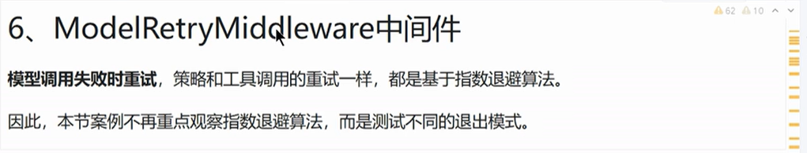

### 举例1：继续运行

```
from datetime import time, datetime

from langchain_core import messages
from langchain.agents.middleware import SummarizationMiddleware, LLMToolSelectorMiddleware, ToolRetryMiddleware, \
    ModelRetryMiddleware
from langchain_core.messages import SystemMessage, HumanMessage, AIMessage
from langchain_core.tools import tool
from typing import Union, Dict, Any
from langchain_openai import ChatOpenAI
from langchain.agents import create_agent
from langgraph.config import get_stream_writer
from rich import print as rprint
from utils.tool_utils import query_weather_from_web,query_news_from_web

agent = create_agent(
    model="ollama:qwen3-vl-cat", # 这个模型是瞎写的
    middleware=[
        ModelRetryMiddleware(
            max_retries=6,
            backoff_factor=2.0,
            initial_delay=1.0,
            max_delay=10.0,
            on_failure='continue',
            jitter=False
        ),
    ]
)
response = agent.invoke({
    "messages": [HumanMessage("你好")]
})

for msg in response["messages"]:
    msg.pretty_print()
```

#### agent输出

```
================================ Human Message =================================

你好
================================== Ai Message ==================================

Model call failed after 7 attempts with ResponseError: model 'qwen3-vl-cat' not found (status code: 404)

```


### 举例2：抛异常

```
from datetime import time, datetime

from langchain_core import messages
from langchain.agents.middleware import SummarizationMiddleware, LLMToolSelectorMiddleware, ToolRetryMiddleware, \
    ModelRetryMiddleware
from langchain_core.messages import SystemMessage, HumanMessage, AIMessage
from langchain_core.tools import tool
from typing import Union, Dict, Any
from langchain_openai import ChatOpenAI
from langchain.agents import create_agent
from langgraph.config import get_stream_writer
from rich import print as rprint
from utils.tool_utils import query_weather_from_web,query_news_from_web

agent = create_agent(
    model="ollama:qwen3-vl-cat", # 这个模型是瞎写的
    middleware=[
        ModelRetryMiddleware(
            max_retries=6,
            backoff_factor=2.0,
            initial_delay=1.0,
            max_delay=10.0,
            on_failure='error',
            jitter=False
        ),
    ]
)
response = agent.invoke({
    "messages": [HumanMessage("你好")]
})

for msg in response["messages"]:
    msg.pretty_print()
```

#### agent输出

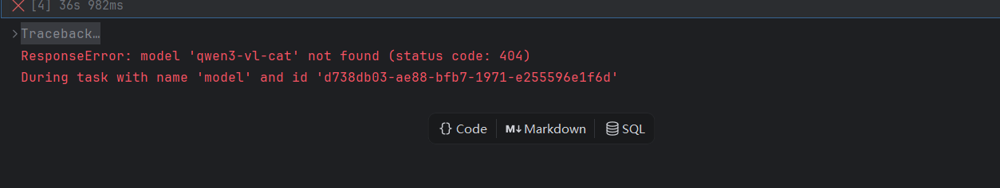


## 3.7 LLMToolEmulator

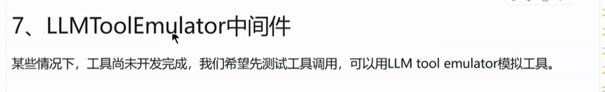

### 举例

```

from langchain_core import messages
from langchain.agents.middleware import SummarizationMiddleware, LLMToolSelectorMiddleware
from langchain_core.messages import SystemMessage, HumanMessage, AIMessage
from langchain_core.tools import tool
from typing import Union, Dict, Any
from langchain_openai import ChatOpenAI
from langchain.agents import create_agent
from langgraph.config import get_stream_writer
from rich import print as rprint
from utils.tool_utils import query_weather_from_web,query_news_from_web

# 1.初始化模型需要2个模型应该是model_out直接给agent使用，另外应该model_in,防止中间件里面
model_out = ChatOpenAI(
    # model="qwen3-vl:latest",
    # model="483025889/qwen3.5:9b",
    model="gemma4:12b",
    api_key="sk12345",
    base_url="http://localhost:11434/v1",
)

model_in = ChatOpenAI(
    model="qwen3-vl:latest",
    # model="483025889/qwen3.5:9b",
    # model="gemma4:12b",
    api_key="sk12345",
    base_url="http://localhost:11434/v1",
)

@tool
def get_weather(city: str):
    """查询指定城市天气"""
    return f"{city}今天天气晴朗"

agent = create_agent(
    model=model_out,
    tools=[get_weather],
    middleware=[
        LLMToolSelectorMiddleware(
            model=model_in,

        ),
    ]
)

response = agent.invoke({
    "messages": [HumanMessage("今天北京天气如何")]
})

for msg in response["messages"]:
    msg.pretty_print()
```

#### agent输出,好像和云端大模型的输出有点不一样

```
================================ Human Message =================================

今天北京天气如何
================================== Ai Message ==================================
Tool Calls:
  get_weather (call_vqrjbzas)
 Call ID: call_vqrjbzas
  Args:
    city: 北京
================================= Tool Message =================================
Name: get_weather

北京今天天气晴朗
================================== Ai Message ==================================

今天北京天气晴朗。

```


## 3.8 ContextEditingMiddleware中间件

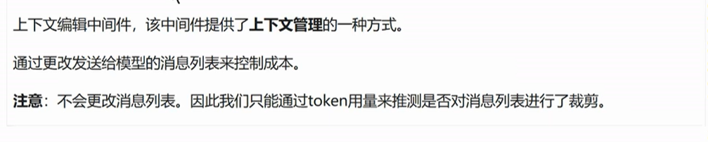

### 1.实验组-启用上下文编辑

```
from langchain.agents.middleware import SummarizationMiddleware, ContextEditingMiddleware, ClearToolUsesEdit
from langchain_core.messages import SystemMessage, HumanMessage, AIMessage
from langchain_core.tools import tool
from langchain_openai import ChatOpenAI
from langchain.agents import create_agent
from rich import print as rprint
from langgraph.checkpoint.memory import InMemorySaver

# 1.初始化模型
model = ChatOpenAI(
    # model="qwen3-vl:latest",
    # model="483025889/qwen3.5:9b",
    model="gemma4:12b",
    profile={"max_input_tokens": 128_000},
    api_key="sk12345",
    base_url="http://localhost:11434/v1",
)

# 全局计数器，用于在工具内部追踪这是第几次被触发
count = 0


@tool
def get_weather(city: str):
    """查询指定城市天气"""
    global count

    # 故意返回一段非常冗长、包含大量 Token 的文本，用于测试中间件的 Token 清理/截断功能
    return (f"当前是第 {count} 次调用工具，{city}今天天气晴朗"
            f"天气非常好，北风，非常适合出行，盼望着，盼望着，"
            f"春天来了。我喜欢春天，你喜欢吗，天气真的很不错"
            f"万里无云，天气晴朗，春和景明，哈哈哈哈哈哈，这是凑字数的"
            f"真不错，天气非常好，适合出行，这里token挺多的"
            f"可以出门玩，可以跑步，钓鱼，爬山，一切都很好哈哈哈")

agent = create_agent(
    model=model,
    tools=[get_weather],
    middleware=[
        ContextEditingMiddleware(
            # 配置“清除工具调用记录”策略
            # 作用：当上下文中的历史消息累积满足特定条件时，自动裁剪/删除旧的工具调用及返回结果
            edits=[
                ClearToolUsesEdit(
                    trigger=50,# 触发阈值（例如：当工具返回的 Token 数或消息数达到设定值时触发，具体取决于LangChain版本实现）
                    keep=0 # 触发清理时，保留最近的几次工具调用。这里设置为 0 代表全部清除旧的工具消息
                )
            ]
        )
    ],
    # 内存检查点管理器：用于保存多轮对话的上下文（实现多轮对话记忆）
    checkpointer=InMemorySaver(),

)

# 配置项：定义会话的 thread_id。相同的 id 代表同一个用户的连续对话
config = {"configurable":{"thread_id":"1"}}
# 模拟连续 3 轮的用户多轮对话
for i in range(3):
     print("=" * 30, f"当前是第 {i + 1} 轮调用", "=" * 30)
     count +=1
     # 调用智能体，传入当前轮次的用户提问，并携带历史会话配置 config
     resp = agent.invoke({"messages":[HumanMessage(f"第 {i + 1} 次询问：今天北京天气如何，一句话回答")]},config=config)
     for msg in resp['messages']:
         # msg.pretty_print()
         if isinstance(msg,AIMessage):
             if not msg.tool_calls:
                 print(f"本次token用量：{msg.usage_metadata}")


```


#### agent输出

```
============================== 当前是第 1 轮调用 ==============================
本次token用量：{'input_tokens': 105, 'output_tokens': 8, 'total_tokens': 113, 'input_token_details': {'cache_read': 66}, 'output_token_details': {}}
============================== 当前是第 2 轮调用 ==============================
本次token用量：{'input_tokens': 105, 'output_tokens': 8, 'total_tokens': 113, 'input_token_details': {'cache_read': 66}, 'output_token_details': {}}
本次token用量：{'input_tokens': 132, 'output_tokens': 92, 'total_tokens': 224, 'input_token_details': {'cache_read': 100}, 'output_token_details': {}}
============================== 当前是第 3 轮调用 ==============================
本次token用量：{'input_tokens': 105, 'output_tokens': 8, 'total_tokens': 113, 'input_token_details': {'cache_read': 66}, 'output_token_details': {}}
本次token用量：{'input_tokens': 132, 'output_tokens': 92, 'total_tokens': 224, 'input_token_details': {'cache_read': 100}, 'output_token_details': {}}
本次token用量：{'input_tokens': 162, 'output_tokens': 146, 'total_tokens': 308, 'input_token_details': {'cache_read': 127}, 'output_token_details': {}}

```


### 说明

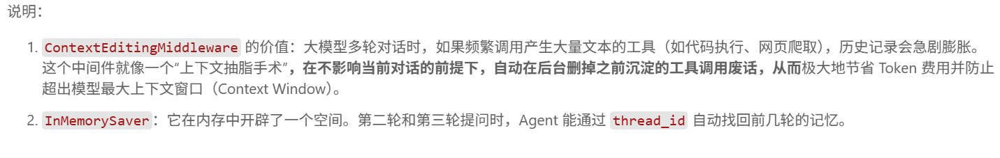

### 2.对照组-不裁剪上下文,没有使用任何中间件

```
from langchain.agents.middleware import SummarizationMiddleware, ContextEditingMiddleware, ClearToolUsesEdit
from langchain_core.messages import SystemMessage, HumanMessage, AIMessage
from langchain_core.tools import tool
from langchain_openai import ChatOpenAI
from langchain.agents import create_agent
from rich import print as rprint
from langgraph.checkpoint.memory import InMemorySaver

# 1.初始化模型
model = ChatOpenAI(
    # model="qwen3-vl:latest",
    # model="483025889/qwen3.5:9b",
    model="gemma4:12b",
    profile={"max_input_tokens": 128_000},
    api_key="sk12345",
    base_url="http://localhost:11434/v1",
)

# 全局计数器，用于在工具内部追踪这是第几次被触发
count = 0


@tool
def get_weather(city: str):
    """查询指定城市天气"""
    global count

    # 故意返回一段非常冗长、包含大量 Token 的文本，用于测试中间件的 Token 清理/截断功能
    return (f"当前是第 {count} 次调用工具，{city}今天天气晴朗"
            f"天气非常好，北风，非常适合出行，盼望着，盼望着，"
            f"春天来了。我喜欢春天，你喜欢吗，天气真的很不错"
            f"万里无云，天气晴朗，春和景明，哈哈哈哈哈哈，这是凑字数的"
            f"真不错，天气非常好，适合出行，这里token挺多的"
            f"可以出门玩，可以跑步，钓鱼，爬山，一切都很好哈哈哈")

# 作为对照，这里不使用中间件
agent = create_agent(
    model=model,
    tools=[get_weather],
    # 内存检查点管理器：用于保存多轮对话的上下文（实现多轮对话记忆）
    checkpointer=InMemorySaver(),

)

# 配置项：定义会话的 thread_id。相同的 id 代表同一个用户的连续对话
config = {"configurable":{"thread_id":"1"}}
# 模拟连续 3 轮的用户多轮对话
for i in range(3):
     print("=" * 30, f"当前是第 {i + 1} 轮调用", "=" * 30)
     count +=1
     # 调用智能体，传入当前轮次的用户提问，并携带历史会话配置 config
     resp = agent.invoke(
         {"messages":[HumanMessage(f"第 {i + 1} 次询问：今天北京天气如何，一句话回答")]},
         config=config
     )
     for msg in resp['messages']:
         # msg.pretty_print()
         if isinstance(msg,AIMessage):
             if not msg.tool_calls:
                 print(f"本次token用量：{msg.usage_metadata}")


```


#### agent输出

```
============================== 当前是第 1 轮调用 ==============================
本次token用量：{'input_tokens': 196, 'output_tokens': 12, 'total_tokens': 208, 'input_token_details': {'cache_read': 66}, 'output_token_details': {}}
============================== 当前是第 2 轮调用 ==============================
本次token用量：{'input_tokens': 196, 'output_tokens': 12, 'total_tokens': 208, 'input_token_details': {'cache_read': 66}, 'output_token_details': {}}
本次token用量：{'input_tokens': 227, 'output_tokens': 101, 'total_tokens': 328, 'input_token_details': {'cache_read': 191}, 'output_token_details': {}}
============================== 当前是第 3 轮调用 ==============================
本次token用量：{'input_tokens': 196, 'output_tokens': 12, 'total_tokens': 208, 'input_token_details': {'cache_read': 66}, 'output_token_details': {}}
本次token用量：{'input_tokens': 227, 'output_tokens': 101, 'total_tokens': 328, 'input_token_details': {'cache_read': 191}, 'output_token_details': {}}
本次token用量：{'input_tokens': 386, 'output_tokens': 98, 'total_tokens': 484, 'input_token_details': {'cache_read': 256}, 'output_token_details': {}}

```

### 可以看到，不裁剪消耗的token非常厉害


## 3.9 FileSystemSearchMiddleware中间件


### 文件夹结构

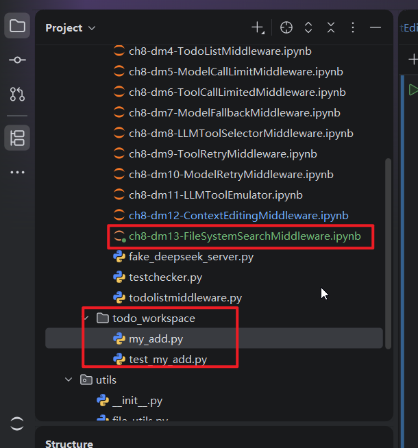

### 参考代码

```
from langchain.agents.middleware import SummarizationMiddleware, ContextEditingMiddleware, ClearToolUsesEdit, \
    FilesystemFileSearchMiddleware
from langchain_core.messages import SystemMessage, HumanMessage, AIMessage
from langchain_core.tools import tool
from langchain_openai import ChatOpenAI
from langchain.agents import create_agent
from rich import print as rprint
from langgraph.checkpoint.memory import InMemorySaver

# 1.初始化模型
model = ChatOpenAI(
    # model="qwen3-vl:latest",
    model="483025889/qwen3.5:9b", # ok
    # model="gemma4:12b", # 这里不好用
    api_key="sk12345",
    base_url="http://localhost:11434/v1",
)

# 2.创建agent
agent = create_agent(
    model=model,
    middleware=[
        FilesystemFileSearchMiddleware(
            root_path="../todo_workspace",
            use_ripgrep=True,
            max_file_size_mb=10
        )
    ]
)

result = agent.invoke({"messages":[
    HumanMessage("找到包含 add 函数的Python或Jupyter文件")
]})

for msg in result["messages"]:
    msg.pretty_print()


```

### agent输出

```
================================ Human Message =================================

找到包含 add 函数的Python或Jupyter文件
================================== Ai Message ==================================
Tool Calls:
  glob_search (call_i1sspbak)
 Call ID: call_i1sspbak
  Args:
    pattern: **/*.py
  glob_search (call_xpm5rfid)
 Call ID: call_xpm5rfid
  Args:
    pattern: **/*.ipynb
================================= Tool Message =================================
Name: glob_search

/my_add.py
/test_my_add.py
================================= Tool Message =================================
Name: glob_search

No files found
================================== Ai Message ==================================
Tool Calls:
  grep_search (call_uefx0cux)
 Call ID: call_uefx0cux
  Args:
    pattern: def\s+add\(
    path: .
    include: *.py
    output_mode: files_with_matches
================================= Tool Message =================================
Name: grep_search

/my_add.py
================================== Ai Message ==================================
Tool Calls:
  grep_search (call_51jplkq2)
 Call ID: call_51jplkq2
  Args:
    pattern: def\s+add\(
    path: .
    include: *.py
    output_mode: content
================================= Tool Message =================================
Name: grep_search

/my_add.py:1:def add(a:int,b:int) -> int:
================================== Ai Message ==================================

已找到包含 `add` 函数的 Python 文件：

- `/my_add.py`

```


## 3.10 Shell tool中间件

## 不支持window,无法测试

## 3.11 Filesystem中间件 无法演示

## 3.12 Subagent中间件 无法演示


# 4.多个中间件组合及执行顺序

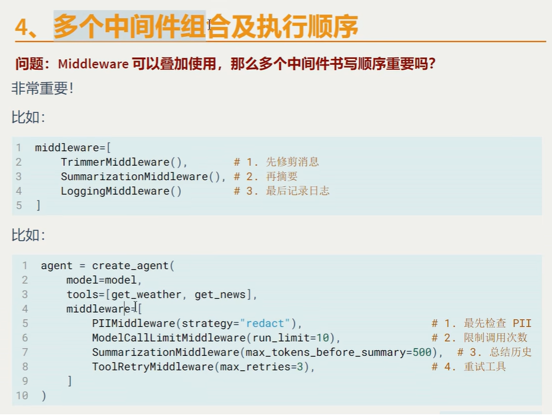

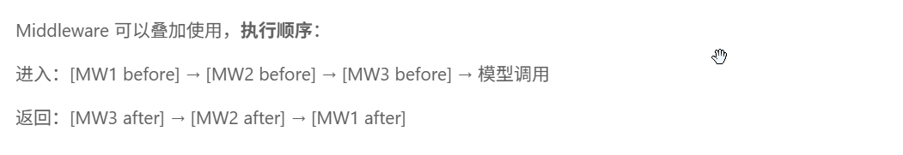

### 举例

```
from langchain.agents import create_agent
from langchain.agents.middleware import FilesystemFileSearchMiddleware
from langchain.messages import HumanMessage
from langchain.agents.middleware import SummarizationMiddleware, ContextEditingMiddleware, ClearToolUsesEdit, \
    FilesystemFileSearchMiddleware
from langchain_core.messages import SystemMessage, HumanMessage, AIMessage
from langchain_core.tools import tool
from langchain_openai import ChatOpenAI
from langchain.agents import create_agent
from rich import print as rprint
from langgraph.checkpoint.memory import InMemorySaver

# 1.初始化模型
model = ChatOpenAI(
    # model="qwen3-vl:latest",
    model="483025889/qwen3.5:9b", # ok
    # model="gemma4:12b", # 这里不好用
    api_key="sk12345",
    base_url="http://localhost:11434/v1",
)
# 2.创建agent
from langchain.agents.middleware import AgentMiddleware


class Middleware1(AgentMiddleware):
    def before_model(self, state, runtime):
        print("[中间件1] before_model")
        return None

    def after_model(self, state, runtime):
        print("[中间件1] after_model")
        return None


class Middleware2(AgentMiddleware):
    def before_model(self, state, runtime):
        print("[中间件2] before_model")
        return None

    def after_model(self, state, runtime):
        print("[中间件2] after_model")
        return None


class Middleware3(AgentMiddleware):
    def before_model(self, state, runtime):
        print("[中间件3] before_model")
        return None

    def after_model(self, state, runtime):
        print("[中间件3] after_model")
        return None


agent = create_agent(
    model=model,
    tools=[],
    middleware=[Middleware3(), Middleware1(), Middleware2()]
)

print("\n执行一次调用，观察顺序：")
agent.invoke({"messages": [{"role": "user", "content": "测试"}]})
```


#### agent输出


# 5.自定义中间件

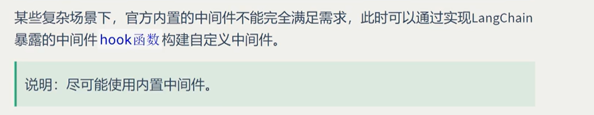

## 5.1什么是hook函数(钩子函数)

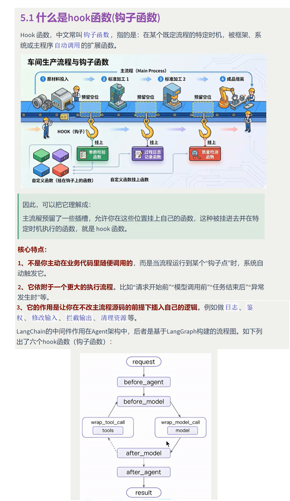


## 5.2LangChain的hook函数分类

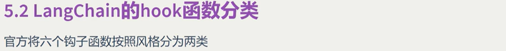

### 类型1： Node-style hooks(节点风格钩子)

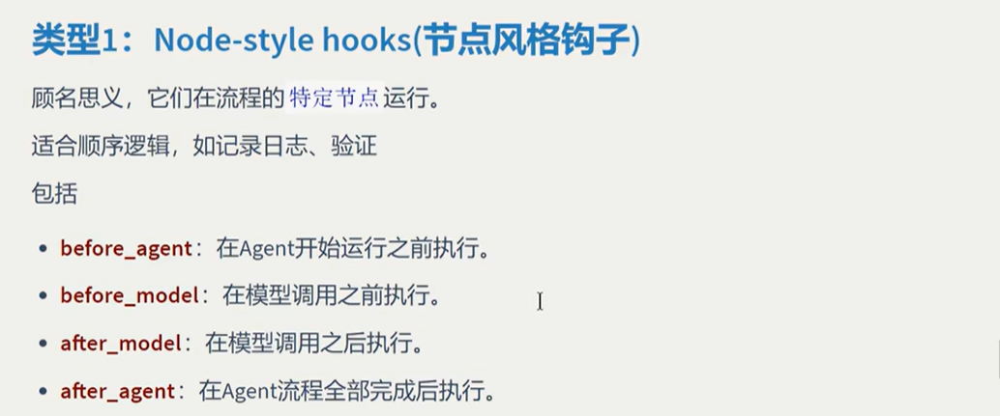

### 类型2： Wrap-style hooks(包装风格钩子)

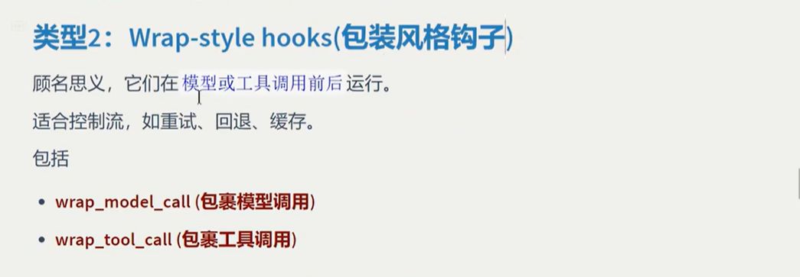

## 5.3 Node-style hooks函数用法

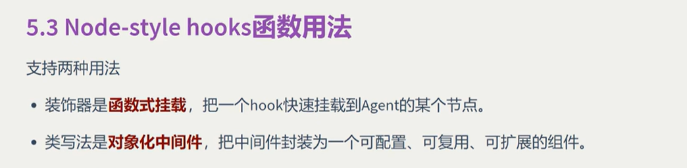

### 5.3.1基本用法

#### 5.3.1.1基于装饰器实现

#### 举例代码1基本用法基于装饰器实现

```
from typing import Any
from langchain.agents.middleware import before_model, after_model, AgentState, before_agent, after_agent, \
    AgentMiddleware
from langgraph.runtime import Runtime
from langchain.messages import HumanMessage
from langchain.agents.middleware import SummarizationMiddleware, ContextEditingMiddleware, ClearToolUsesEdit, \
    FilesystemFileSearchMiddleware
from langchain_core.messages import SystemMessage, HumanMessage, AIMessage
from langchain_core.tools import tool
from langchain_openai import ChatOpenAI
from langchain.agents import create_agent
from rich import print as rprint
from langgraph.checkpoint.memory import InMemorySaver

@before_model()
def before_model_middleware(state: AgentState, runtime: Runtime) -> dict[str, Any] | None:
    state["messages"][-1].content += "----> before_model <-----"
    return None

@after_model()
def after_model_middleware(state: AgentState, runtime: Runtime) -> dict[str, Any] | None:
    state["messages"][-1].content += "----> after_model <-----"
    return None

@before_agent()
def before_agent_middleware(state: AgentState, runtime: Runtime) -> dict[str, Any] | None:
    state["messages"][-1].content += "----> before_agent <-----"
    return None

@after_agent()
def after_agent_middleware(state: AgentState, runtime: Runtime) -> dict[str, Any] | None:
    state["messages"][-1].content += "----> after_agent <-----"
    return None

# 1.初始化模型
model = ChatOpenAI(
    # model="qwen3-vl:latest",
    model="483025889/qwen3.5:9b", # ok
    # model="gemma4:12b", # 这里不好用
    api_key="sk12345",
    base_url="http://localhost:11434/v1",
)

agent = create_agent(
    model=model,
    middleware=[before_model_middleware, after_model_middleware,before_agent_middleware, after_agent_middleware],
)

response = agent.invoke({
    "messages": [HumanMessage("2的12次方等于几")]
})

for msg in response["messages"]:
    msg.pretty_print()
```

#### agent输出

```
================================ Human Message =================================

2的12次方等于几----> before_agent <---------> before_model <-----
================================== Ai Message ==================================

2 的 12 次方等于 **4096**。

计算过程简述：
$2^{12} = 2^{10} \times 2^2 = 1024 \times 4 = 4096$。----> after_model <---------> after_agent <-----

```

#### 5.3.1.2 基于类实现


#### 举例代码1基本用法

```
from typing import Any
from langchain.agents.middleware import AgentMiddleware,AgentState, before_agent, after_agent
from langgraph.runtime import Runtime
from langchain.messages import HumanMessage
from langchain.agents.middleware import SummarizationMiddleware, ContextEditingMiddleware, ClearToolUsesEdit, \
    FilesystemFileSearchMiddleware
from langchain_core.messages import SystemMessage, HumanMessage, AIMessage
from langchain_core.tools import tool
from langchain_openai import ChatOpenAI
from langchain.agents import create_agent
from rich import print as rprint
from langgraph.checkpoint.memory import InMemorySaver

## 使用类的方式，方法名称是有讲究的，一定得是before_agent,after_agent,before_model,after_model
class MyMiddleware(AgentMiddleware): # 中间件类
    def before_model(self,state: AgentState, runtime: Runtime) -> dict[str, Any] | None:
        state["messages"][-1].content += "----> before_model <-----"
        return None

    def after_model(self,state: AgentState, runtime: Runtime) -> dict[str, Any] | None:
        state["messages"][-1].content += "----> after_model <-----"
        return None


    def before_agent(self,state: AgentState, runtime: Runtime) -> dict[str, Any] | None:
        state["messages"][-1].content += "----> before_agent <-----"
        return None

    def after_agent(self,state: AgentState, runtime: Runtime) -> dict[str, Any] | None:
        state["messages"][-1].content += "----> after_agent <-----"
        return None

middleware = MyMiddleware()

# 1.初始化模型
model = ChatOpenAI(
    # model="qwen3-vl:latest",
    model="483025889/qwen3.5:9b", # ok
    # model="gemma4:12b", # 这里不好用
    api_key="sk12345",
    base_url="http://localhost:11434/v1",
)

agent = create_agent(
    model=model,
    middleware=[middleware],
)

response = agent.invoke({
    "messages": [HumanMessage("2的12次方等于几")]
})

for msg in response["messages"]:
    msg.pretty_print()
```

#### agent输出

```
================================ Human Message =================================

2的12次方等于几----> before_agent <---------> before_model <-----
================================== Ai Message ==================================

2的12次方等于 **4096**。  
计算过程：2^10 = 1024，因此 2^12 = 1024 × 2² = 1024 × 4 = **4096**。  

常见用途：计算机中常用此数值（如内存、存储容量单位过渡）。----> after_model <---------> after_agent <-----

```

#### 使用场景


### 5.3.2两种方法的统一


### 5.3.3 参数说明


### 5.3.4.返回值说明


### 5.3.5 装饰器参数：can_jump_to


#### 5.3.5.1 基于装饰器实现

```
from typing import Any
from langchain.agents.middleware import before_model, after_model, AgentState
from langgraph.runtime import Runtime
from langchain.messages import HumanMessage
from langchain.agents.middleware import SummarizationMiddleware, ContextEditingMiddleware, ClearToolUsesEdit, \
    FilesystemFileSearchMiddleware
from langchain_core.messages import SystemMessage, HumanMessage, AIMessage
from langchain_core.tools import tool
from langchain_openai import ChatOpenAI
from langchain.agents import create_agent
from rich import print as rprint
from langgraph.checkpoint.memory import InMemorySaver

# 1.初始化模型
model = ChatOpenAI(
    # model="qwen3-vl:latest",
    model="483025889/qwen3.5:9b", # ok
    # model="gemma4:12b", # 这里不好用
    api_key="sk12345",
    base_url="http://localhost:11434/v1",
)

@tool
def get_news() -> str:
    """获取当日新闻"""
    return f"美加墨世界杯今日开幕"

# 在模型（LLM）执行前触发。允许跳转到 "tools" 节点。
@before_model(can_jump_to=["tools"])
def force_tool_first(state: AgentState,runtime:Runtime) -> dict[str, Any] | None:
    """
    【业务场景：强行拦截并触发工具】
    如果用户输入包含 "direct tool"，则跳过本次大模型的思考/生成阶段，
    直接伪造一个大模型的 tool_calls 意图，强行把控制权移交给工具执行节点。
    """
    text = state["messages"][-1].content
    if isinstance(text,str) and "direct tool" in text:
        print("[MIDDLEWARE] before_model: jump_to='tools'")

        # 人工构造一个大模型的消息对象（AIMessage）
        # 欺骗系统，让系统误以为这是模型自己决定要调用的工具
        fake_toolcall=AIMessage(
            content="人工构造消息",
            tool_calls=[
                {
                    "name":"get_news",
                    "args":{},
                     "id": "call_force_weather_001",
                }
            ]
        )

        # 返回更新后的状态：注入伪造的消息，并明确指定下一步跳转到 "tools" 节点
        return {
            "messages":[fake_toolcall],
            "jump_to":"tools",
        }
    # 如果不满足触发条件，返回 None，流程正常向下流转（继续让 LLM 思考）
    return None

# 在模型（LLM）执行生成之后触发。允许重新跳转回 "model" 节点。
@after_model(can_jump_to=["model"])
def retry_with_extra_instruction(state: AgentState, runtime: Runtime) -> dict[str, Any] | None:
    """
    【业务场景：反思/重试机制】
    如果大模型已经生成了回答，但发现用户最初的请求包含 "retry model"，
    则动态追加一条系统提示词（SystemMessage），强行让模型重新生成（重试）一次。
    """
    # 倒序遍历消息历史，找到最近的一次用户输入（human 消息）
    user_text = ""
    for msg in reversed(state["messages"]):
        if getattr(msg,"type","") == "human":
            user_text = getattr(msg,"content","")
            break
    # 检查用户输入是否包含触发重试的关键字
    if isinstance(user_text,str) and "retry model" in user_text.lower():
         # 【核心防御】：防止无限循环重跳（死循环）
         # 检查消息历史中是否已经注入过这条特殊的系统提示。如果有，说明已经重试过了，不再重复干预。
         already_injected = any(
           isinstance(getattr(msg,"content",None),str)
           and "你必须以【二次回答】开头" in msg.content
           for msg in state["messages"]
         )
         if already_injected:
             return None  # 已注入过，直接放行，结束重试流程
         print("[MIDDLEWARE] retry_with_extra_instruction: jump_to='model' with extra system instruction")
         # 返回更新后的状态：追加强力约束的系统消息，并将指针跳回 "model" 节点重新执行
         return {
             "messages":[SystemMessage("你必须以【二次回答】开头，并且只用一句话回答。")],
             "jump_to":"model",
         }


# 在模型（LLM）执行前触发。允许直接跳转到 "end" 节点（强行终止）。
@before_model(can_jump_to=["end"])
def overflow_context_processor(state: AgentState, runtime: Runtime) -> dict[str, Any] | None:
    """
    【业务场景：安全卫士/异常拦截】
    模拟上下文窗口溢出（Token超限）或其他严重的系统阻断情况。
    一旦触发，直接熔断流程，拒绝让大模型继续处理，直接报错或返回兜底文案。
    """
    # 假装溢出,模拟检查最后一条消息是否包含 overflow 标识
    if "overflow" in state["messages"][-1].content:
        print("[MIDDLEWARE] before_model: jump_to='end' when contenxt window overflow")

        # 构造兜底的结束消息，并直接指定跳转到 "end" 终止 Agent 运行
        return {
            "messages":[AIMessage("上下文窗口溢出，终止")],
            "jump_to":"end",
        }

agent = create_agent(
    model=model,
    tools=[get_news],
    # # 将定义的中间件按照顺序挂载到 Agent 中（注意：执行顺序会严格按照列表声明顺序）
    middleware=[force_tool_first,retry_with_extra_instruction,overflow_context_processor],
)

def run_once(user_input:str):
    resp = agent.invoke({
        "messages":[{"role": "user", "content": user_input}]
    })

    for msg in resp["messages"]:
        msg.pretty_print()

if __name__ == "__main__":
    # Case 1: 直接跳 tools
    # 预期表现：
    # 1. 触发 force_tool_first，打印 "[MIDDLEWARE] before_model: jump_to='tools'"
    # 2. 绕过 LLM 的首轮思考，直接调用 `get_news` 工具
    # 3. 工具返回结果后，LLM 总结工具结果并输出
    print('=' * 30, '-> Case 1 <-', '=' * 30)
    run_once("请帮我查今日新闻 direct tool")

    # Case 2: 输出后跳回 model
    # 预期表现：
    # 1. 正常进入 LLM 生成第 1 版回答
    # 2. 触发 retry_with_extra_instruction，打印 "[MIDDLEWARE] after_model: jump_to='model'..."
    # 3. 注入系统提示词后，LLM 被强行拉回并生成第 2 版回答
    # 4. 最终输出应带有“【二次回答】”前缀
    print('=' * 30, '-> Case 2 <-', '=' * 30)
    run_once("请随便介绍一下 LangChain retry model")

    # Case 3:
    # 预期表现：
    # 1. 触发 overflow_context_processor 中间件
    # 2. 直接打印终止信息并退出，LLM 根本不会接收到这个请求
    print('=' * 30, '-> Case 3 <-', '=' * 30)
    run_once("你好 overflow")
    # Case 4: 正常流程
    # 预期表现：
    # 1. 没有任何中间件被触发（不满足任何关键字）
    # 2. Agent 走正常的 OOTB（Out of the box）标准工作流：User -> Model -> Call Tool -> Model -> End
    print('=' * 30, '-> Case 4 <-', '=' * 30)
    run_once("今日新闻摘要？")
```

#### agent输出

````
============================== -> Case 1 <- ==============================
[MIDDLEWARE] before_model: jump_to='tools'
================================ Human Message =================================

请帮我查今日新闻 direct tool
================================== Ai Message ==================================

人工构造消息
Tool Calls:
  get_news (call_force_weather_001)
 Call ID: call_force_weather_001
  Args:
================================= Tool Message =================================
Name: get_news

美加墨世界杯今日开幕
================================== Ai Message ==================================

以下是为您获取的今日热点新闻：

**新闻标题：** 美加墨世界杯今盛大开幕
**内容：** 今日正值国际足联世界杯开幕，备受瞩目的赛事在北美三国正式拉开帷幕。
============================== -> Case 2 <- ==============================
[MIDDLEWARE] retry_with_extra_instruction: jump_to='model' with extra system instruction
================================ Human Message =================================

请随便介绍一下 LangChain retry model
================================== Ai Message ==================================

LangChain 是一个用于创建语言模型应用程序的软件框架，它不直接拥有叫做 “retry model” 的特定模型。不过，您可能是想了解 LangChain 在 AI模型应用中的错误处理与自动重试机制，这是其重要特性之一。

## LangChain 中的重试（Retry）功能说明

LangChain 提供了强大的错误恢复和重试机制，帮助用户在使用大语言模型时更加稳定地处理请求失败、超时等问题。以下是主要相关内容：

### 1. **Retry Configuration**
在调用多个 LLM（Language Model）时，可以通过配置来指定在特定条件下自动重新发送请求的选项。通常与运行环境结合使用，比如 `RunnableWithRetry` 等工具。

### 2. **Retry on Exception**
当某个工具、回调或模型执行失败时，LangChain 允许设置是否应重试。例如：
- API 错误（如429过多请求、503服务不可用）
- 请求超时（Request Timeout）
- Token 限制导致的中断

### 3. **Retry Parameters**
常见的可配置项包括：
- `max_retries`: 最大重试次数（例如设置为0表示不重试）
- `retry_after_milliseconds`: 每次重试之间的延迟时间（如指数退避策略）
- `retryable_exceptions`: 需要重试的异常类型（例如429、500、Timeout等）

### 4. **Retry Example**
```python
# 示例：使用 LangChain 的工具进行 LLM 调用并配置重试机制
from langchain_retry import RunnableWithRetry

llm = ChatOpenAI(model="gpt-3.5-turbo")
retried_llm = RunnableWithRetry(llm, max_retries=2)

response = retried_llm.run("写一段代码")
```

### 5. **最佳实践**
- 合理设置重试次数和间隔时间，避免对服务器造成压力
- 结合监控工具（如 OpenTelemetry）记录重试日志和数据，便于追踪问题
- 对于关键业务场景，建议限制重试逻辑并使用人工回退机制

## 总结

LangChain中的“retry model”并非独立存在的模型，而是指在 AI调用过程中，框架提供的自动错误恢复和请求重试能力。这一设计确保了应用在面对网络波动、API异常时仍能保持稳定运行。如果您有特定场景或配置需求，可以进一步说明，我可以提供更针对性的建议或代码示例。
================================ System Message ================================

你必须以【二次回答】开头，并且只用一句话回答。
================================== Ai Message ==================================

【二次回答】LangChain 中的重试机制主要通过配置错误处理和自动重传来提高 AI 应用稳定性，而非独立的重试模型。
============================== -> Case 3 <- ==============================
[MIDDLEWARE] before_model: jump_to='end' when contenxt window overflow
================================ Human Message =================================

你好 overflow
================================== Ai Message ==================================

上下文窗口溢出，终止
============================== -> Case 4 <- ==============================
================================ Human Message =================================

今日新闻摘要？
================================== Ai Message ==================================
Tool Calls:
  get_news (call_krx5mqox)
 Call ID: call_krx5mqox
  Args:
================================= Tool Message =================================
Name: get_news

美加墨世界杯今日开幕
================================== Ai Message ==================================

今日的热门新闻是：**美加墨世界杯今日开幕**。这是一个备受全球瞩目的国际体育赛事开端，想必有许多精彩比赛即将上演！

````


#### 5.3.5.2 基于类实现


```
from typing import Any
from langchain.agents.middleware import before_model, after_model, AgentState, hook_config
from langgraph.runtime import Runtime
from langchain.messages import HumanMessage
from langchain.agents.middleware import SummarizationMiddleware, ContextEditingMiddleware, ClearToolUsesEdit, \
    FilesystemFileSearchMiddleware
from langchain_core.messages import SystemMessage, HumanMessage, AIMessage
from langchain_core.tools import tool
from langchain_openai import ChatOpenAI
from langchain.agents import create_agent
from rich import print as rprint
from langgraph.checkpoint.memory import InMemorySaver

# 1.初始化模型
model = ChatOpenAI(
    # model="qwen3-vl:latest",
    model="483025889/qwen3.5:9b", # ok
    # model="gemma4:12b", # 这里不好用
    api_key="sk12345",
    base_url="http://localhost:11434/v1",
)

@tool
def get_news() -> str:
    """获取当日新闻"""
    return f"美加墨世界杯今日开幕"


class MyMiddleware(AgentMiddleware):
    # 在模型（LLM）执行前触发。允许跳转到 "tools" 节点。
    @hook_config(can_jump_to=["tools"])
    def force_tool_first(state: AgentState,runtime:Runtime) -> dict[str, Any] | None:
        """
        【业务场景：强行拦截并触发工具】
        如果用户输入包含 "direct tool"，则跳过本次大模型的思考/生成阶段，
        直接伪造一个大模型的 tool_calls 意图，强行把控制权移交给工具执行节点。
        """
        text = state["messages"][-1].content
        if isinstance(text,str) and "direct tool" in text:
            print("[MIDDLEWARE] before_model: jump_to='tools'")

            # 人工构造一个大模型的消息对象（AIMessage）
            # 欺骗系统，让系统误以为这是模型自己决定要调用的工具
            fake_toolcall=AIMessage(
                content="人工构造消息",
                tool_calls=[
                    {
                        "name":"get_news",
                        "args":{},
                         "id": "call_force_weather_001",
                    }
                ]
            )

            # 返回更新后的状态：注入伪造的消息，并明确指定下一步跳转到 "tools" 节点
            return {
                "messages":[fake_toolcall],
                "jump_to":"tools",
            }
        # 如果不满足触发条件，返回 None，流程正常向下流转（继续让 LLM 思考）
        return None

    # 在模型（LLM）执行生成之后触发。允许重新跳转回 "model" 节点。
    @hook_config(can_jump_to=["model"])
    def retry_with_extra_instruction(state: AgentState, runtime: Runtime) -> dict[str, Any] | None:
        """
        【业务场景：反思/重试机制】
        如果大模型已经生成了回答，但发现用户最初的请求包含 "retry model"，
        则动态追加一条系统提示词（SystemMessage），强行让模型重新生成（重试）一次。
        """
        # 倒序遍历消息历史，找到最近的一次用户输入（human 消息）
        user_text = ""
        for msg in reversed(state["messages"]):
            if getattr(msg,"type","") == "human":
                user_text = getattr(msg,"content","")
                break
        # 检查用户输入是否包含触发重试的关键字
        if isinstance(user_text,str) and "retry model" in user_text.lower():
             # 【核心防御】：防止无限循环重跳（死循环）
             # 检查消息历史中是否已经注入过这条特殊的系统提示。如果有，说明已经重试过了，不再重复干预。
             already_injected = any(
               isinstance(getattr(msg,"content",None),str)
               and "你必须以【二次回答】开头" in msg.content
               for msg in state["messages"]
             )
             if already_injected:
                 return None  # 已注入过，直接放行，结束重试流程
             print("[MIDDLEWARE] retry_with_extra_instruction: jump_to='model' with extra system instruction")
             # 返回更新后的状态：追加强力约束的系统消息，并将指针跳回 "model" 节点重新执行
             return {
                 "messages":[SystemMessage("你必须以【二次回答】开头，并且只用一句话回答。")],
                 "jump_to":"model",
             }


    # 在模型（LLM）执行前触发。允许直接跳转到 "end" 节点（强行终止）。
    @hook_config(can_jump_to=["end"])
    def overflow_context_processor(state: AgentState, runtime: Runtime) -> dict[str, Any] | None:
        """
        【业务场景：安全卫士/异常拦截】
        模拟上下文窗口溢出（Token超限）或其他严重的系统阻断情况。
        一旦触发，直接熔断流程，拒绝让大模型继续处理，直接报错或返回兜底文案。
        """
        # 假装溢出,模拟检查最后一条消息是否包含 overflow 标识
        if "overflow" in state["messages"][-1].content:
            print("[MIDDLEWARE] before_model: jump_to='end' when contenxt window overflow")

            # 构造兜底的结束消息，并直接指定跳转到 "end" 终止 Agent 运行
            return {
                "messages":[AIMessage("上下文窗口溢出，终止")],
                "jump_to":"end",
            }

middleware = MyMiddleware() # 实例化中间件对象

agent = create_agent(
    model=model,
    tools=[get_news],
    # # 将定义的中间件按照顺序挂载到 Agent 中（注意：执行顺序会严格按照列表声明顺序）
    middleware=[middleware],
)

def run_once(user_input:str):
    resp = agent.invoke({
        "messages":[{"role": "user", "content": user_input}]
    })

    for msg in resp["messages"]:
        msg.pretty_print()

if __name__ == "__main__":
    # Case 1: 直接跳 tools
    # 预期表现：
    # 1. 触发 force_tool_first，打印 "[MIDDLEWARE] before_model: jump_to='tools'"
    # 2. 绕过 LLM 的首轮思考，直接调用 `get_news` 工具
    # 3. 工具返回结果后，LLM 总结工具结果并输出
    print('=' * 30, '-> Case 1 <-', '=' * 30)
    run_once("请帮我查今日新闻 direct tool")

    # Case 2: 输出后跳回 model
    # 预期表现：
    # 1. 正常进入 LLM 生成第 1 版回答
    # 2. 触发 retry_with_extra_instruction，打印 "[MIDDLEWARE] after_model: jump_to='model'..."
    # 3. 注入系统提示词后，LLM 被强行拉回并生成第 2 版回答
    # 4. 最终输出应带有“【二次回答】”前缀
    print('=' * 30, '-> Case 2 <-', '=' * 30)
    run_once("请随便介绍一下 LangChain retry model")

    # Case 3:
    # 预期表现：
    # 1. 触发 overflow_context_processor 中间件
    # 2. 直接打印终止信息并退出，LLM 根本不会接收到这个请求
    print('=' * 30, '-> Case 3 <-', '=' * 30)
    run_once("你好 overflow")
    # Case 4: 正常流程
    # 预期表现：
    # 1. 没有任何中间件被触发（不满足任何关键字）
    # 2. Agent 走正常的 OOTB（Out of the box）标准工作流：User -> Model -> Call Tool -> Model -> End
    print('=' * 30, '-> Case 4 <-', '=' * 30)
    run_once("今日新闻摘要？")
```

#### agent输出

````
============================== -> Case 1 <- ==============================
================================ Human Message =================================

请帮我查今日新闻 direct tool
================================== Ai Message ==================================
Tool Calls:
  get_news (call_exaec07q)
 Call ID: call_exaec07q
  Args:
================================= Tool Message =================================
Name: get_news

美加墨世界杯今日开幕
================================== Ai Message ==================================

今日新闻：美加墨世界杯今日开幕。
============================== -> Case 2 <- ==============================
================================ Human Message =================================

请随便介绍一下 LangChain retry model
================================== Ai Message ==================================

# LangChain Retry Model 介绍

LangChain 的 **Retry Model（重试模型）** 是指在处理链式调用或大语言模型交互时，当某一环节（如 API 请求、工具调用等）失败后自动进行重试的机制。这是提高应用健壮性和成功率的重要设计。

## 核心特点

### 1. **重试机制原理**
```python
from langchain_core.retries import RetryCondition
from langchain_retry_models import RetryModel

# 当遇到特定错误时（如 API 429、超时等），自动触发重试策略
retry_model = RetryModel(max_retries=3, wait_time=5)
```

### 2. **适用场景**
- LLM 服务响应超时而失败
- API 限流导致请求被拒绝（HTTP 429）
- 网络波动或中间故障
- 工具调用函数执行异常

### 3. **常见配置参数**
| 参数 | 说明 | 示例值 |
|------|------|--------|
| `max_retries` | 最大重试次数 | 3~5 |
| `wait_time` | 首次等待时间（指数退避） | 10秒左右 |
| `retry_conditions` | 触发重试的错误类型列表 | `[429, 500, Timeout]` |

### 4. **优势**
- 提高成功调用率，避免因瞬间故障中断流程
- 减少服务抖动对业务的影响
- 提升用户体验的稳定性

### 5. **注意事项**
⚠️ 建议设置重试次数上限，防止无限循环  
⚠️ 需要避免重复提交相同请求  
⚠️ 可配合指数退避算法（Exponential Backoff）优化等待策略  

如需更详细的配置示例或源码说明，可以查看 LangChain 官方文档 `~core/retries/` 相关路径。
============================== -> Case 3 <- ==============================
================================ Human Message =================================

你好 overflow
================================== Ai Message ==================================

你好！😊 很高兴见到你！有什么可以帮助你的吗？我可以帮你查询新闻、解答问题，或者做其他的的事情。请告诉我你需要什么帮助～
============================== -> Case 4 <- ==============================
================================ Human Message =================================

今日新闻摘要？
================================== Ai Message ==================================
Tool Calls:
  get_news (call_08rbgbs8)
 Call ID: call_08rbgbs8
  Args:
================================= Tool Message =================================
Name: get_news

美加墨世界杯今日开幕
================================== Ai Message ==================================

今日有一条重要新闻：美加墨世界杯已正式开幕。

````


## 5.4 Wrap-style hooks函数的用法


### 5.4.1基本用法

#### 1.基于装饰器实现


##### ①wrap_model_call

##### 使用场景


###### 场景1


###### 场景2


###### 场景3.修改系统提示


###### 代码实现

```
from langchain.messages import HumanMessage
from langchain.agents.middleware import AgentMiddleware,wrap_model_call,ModelRequest,ModelResponse
from langchain_core.messages import SystemMessage, HumanMessage, AIMessage
from langchain_core.tools import tool
from langchain_openai import ChatOpenAI
from typing import Callable
from langchain.agents import create_agent
from rich import print as rprint
from langgraph.checkpoint.memory import InMemorySaver


@wrap_model_call
def wrap_model_call_middleware(request:ModelRequest,handler:Callable[[ModelRequest],ModelResponse])-> ModelResponse | None:
    request.messages[-1].content += "---> wrap_model_call_before <---"
    # 模型的调用
    response = handler(request)
    response.result[0].content += "---> wrap_model_call_after <---"

    return response

# 1.初始化模型
model = ChatOpenAI(
    # model="qwen3-vl:latest",
    model="483025889/qwen3.5:9b", # ok
    # model="gemma4:12b", # 这里不好用
    api_key="sk12345",
    base_url="http://localhost:11434/v1",
)

# 2.创建agent
agent = create_agent(
    model=model,
    middleware=[
        wrap_model_call_middleware
    ]
)

resp = agent.invoke({"messages":[HumanMessage("你好")]})
for msg in resp['messages']:
    msg.pretty_print()
```

##### agent输出

```
================================ Human Message =================================

你好---> wrap_model_call_before <---
================================== Ai Message ==================================

你好！看起来你提到了 `wrap_model_call_before`，这可能是一个系统函数名称或工作流标识符。

不过我这边没有具体的上下文信息（比如是哪个平台/系统的具体模块）。为了更好地帮助你：

| 可能含义 | 说明 |
|---------|------|
| **函数标识** | 可能是某代码库中的包装器函数 |
| **流程节点** | 可能是编排/工作流系统的处理环节 |
| **API 端点** | 可能是后端服务的接口名之一 |

如果你能告诉我：
- 这是哪个系统/平台的功能？
- 你遇到了什么问题或有什么需求？

我会更具体地帮助你！😊---> wrap_model_call_after <---

```


##### ②wrap_tool_call

##### 使用场景


##### 举例代码
```
from langchain.messages import HumanMessage,ToolMessage
from langchain.agents.middleware import AgentMiddleware,wrap_tool_call,ToolCallRequest
from langchain_core.messages import SystemMessage, HumanMessage, AIMessage
from langchain_core.tools import tool
from langchain_openai import ChatOpenAI
from typing import Callable
from langchain.agents import create_agent
from langgraph.types import Command
from rich import print as rprint
from typing import Any

@tool
def get_weather(city: str, is_forcast: bool) -> str:
    """
    获取当日特定城市的天气

    Args:
        city: 城市名称
        is_forcast: 是否包含明天的天气预报
    """
    res = f"{city}今天天气不错"
    if is_forcast:
        res += "\n明天天气也很好"
    return res


@wrap_tool_call
def wrap_tool_call_middleware(request:ToolCallRequest,handler: Callable[[ToolCallRequest], ToolMessage | Command[Any]],) -> ToolMessage | Command[Any]:
    result = handler(request)
    print(f"原始参数：{request.tool_call['args']}")
    print(f"原始参数调用结果：{result}")

    # 修改工具参数的值
    request.tool_call['args']['is_forcast'] = True
    result = handler(request)
    print(f"修改后参数：{request.tool_call['args']}")
    print(f"修改后调用结果：{result}")

    return result

# 1.初始化模型
model = ChatOpenAI(
    # model="qwen3-vl:latest",
    model="483025889/qwen3.5:9b", # ok
    # model="gemma4:12b", # 这里不好用
    api_key="sk12345",
    base_url="http://localhost:11434/v1",
)

# 2.创建agent
agent = create_agent(
    model=model,
    tools=[get_weather],
    middleware=[
     wrap_tool_call_middleware,
    ]
)

resp = agent.invoke({"messages":[HumanMessage("帮我查询北京今天的天气如何？")]})
for msg in resp['messages']:
    msg.pretty_print()
```

##### agent输出

```
原始参数：{'city': '北京', 'is_forcast': False}
原始参数调用结果：content='北京今天天气不错' name='get_weather' tool_call_id='call_eib6ha6t'
修改后参数：{'city': '北京', 'is_forcast': True}
修改后调用结果：content='北京今天天气不错\n明天天气也很好' name='get_weather' tool_call_id='call_eib6ha6t'
================================ Human Message =================================

帮我查询北京今天的天气如何？
================================== Ai Message ==================================
Tool Calls:
  get_weather (call_eib6ha6t)
 Call ID: call_eib6ha6t
  Args:
    city: 北京
    is_forcast: True
================================= Tool Message =================================
Name: get_weather

北京今天天气不错
明天天气也很好
================================== Ai Message ==================================

北京今天的天气很不错哦，另外明天的天气预报显示天气也会很好～

```


#### 2.基于类实现

##### ①wrap_model_call

```
from langchain.messages import HumanMessage
from langchain.agents.middleware import AgentMiddleware,wrap_model_call,ModelRequest,ModelResponse
from langchain_core.messages import SystemMessage, HumanMessage, AIMessage
from langchain_core.tools import tool
from langchain_openai import ChatOpenAI
from typing import Callable
from langchain.agents import create_agent
from rich import print as rprint
from langgraph.checkpoint.memory import InMemorySaver

class WrapModelCallMiddleware(AgentMiddleware):
    def wrap_model_call(self,request:ModelRequest,handler:Callable[[ModelRequest],ModelResponse])-> ModelResponse | None:
        request.messages[-1].content += "---> wrap_model_call_before <---"
        # 模型的调用
        response = handler(request)
        response.result[0].content += "---> wrap_model_call_after <---"

        return response
# 1.初始化模型
model = ChatOpenAI(
    # model="qwen3-vl:latest",
    model="483025889/qwen3.5:9b", # ok
    # model="gemma4:12b", # 这里不好用
    api_key="sk12345",
    base_url="http://localhost:11434/v1",
)

wc_middleware = WrapModelCallMiddleware()

# 2.创建agent
agent = create_agent(
    model=model,
    middleware=[
        wc_middleware
    ]
)

resp = agent.invoke({"messages":[HumanMessage("你好")]})
for msg in resp['messages']:
    msg.pretty_print()
```

##### agent输出

````
================================ Human Message =================================

你好---> wrap_model_call_before <---
================================== Ai Message ==================================

你好！你提到的 `wrap_model_call_before` 和 `wrap_model_call_after` 看起来可能存在拼写或逻辑上的混淆。以下是可能的解决方案：

---

### 1. **确认函数名是否正确**
   - 如果项目中同时存在 `wrap_model_call_before` 和 `wrap_model_call_after`，请确保它们的调用顺序符合预期（比如 `before` 应在处理前执行，`after` 在处理后执行）。
   - 检查是否有拼写错误，例如：
     ```python
     # ❌ 错误的用法（重复的 before）
     wrap_model_call_before_wrap_model_call_after
   
     # ✅ 正确用法（按设计意图）
     def my_handler(event, context):
         ...
     
     events = [
       event('wrap_model_call_before').trigger(handler=my_handler),
       event('wrap_model_call_after').trigger(handler=my_handler)
     ]
     ```

---

### 2. **需求澄清**
   - **场景**：你是在开发事件驱动架构，还是构建装饰器？
   - **框架**：是否基于特定框架（如 AWS Lambda 事件源、FastAPI 等）？不同框架的命名规范可能不同。
   - **问题**：是否需要将两个逻辑合并为一个统一的钩子函数？例如 `wrap_model_call` + `before/after` 装饰器？

---

### 3. **代码示例建议**
```python
# ✅ 推荐做法：分离 before/after 逻辑
@wrap_model_call_before_handler
def preprocess_data():
    # 预处理逻辑（如验证输入）
    pass

@wrap_model_call_after_handler
def postprocess_result(result):
    # 后处理逻辑（如日志记录、发送通知）
    return result
```

---

### 4. **需要进一步的信息**
   - 请提供以下信息以便更精准解答：
     - ❓ 你期望的完整功能流程？
     - ❓ 当前代码中出错的报错信息或异常堆栈？
     - ❓ 项目框架/环境（如 AWS Lambda、本地 Python 应用等）？

希望这些建议能帮你快速定位问题！如果需要更具体的帮助，可以补充代码片段哦～ 😊---> wrap_model_call_after <---

````


##### ②wrap_tool_call

```
from langchain.messages import HumanMessage,ToolMessage
from langchain.agents.middleware import AgentMiddleware,wrap_tool_call,ToolCallRequest
from langchain_core.messages import SystemMessage, HumanMessage, AIMessage
from langchain_core.tools import tool
from langchain_openai import ChatOpenAI
from typing import Callable
from langchain.agents import create_agent
from langgraph.types import Command
from rich import print as rprint
from typing import Any

@tool
def get_weather(city: str, is_forcast: bool) -> str:
    """
    获取当日特定城市的天气

    Args:
        city: 城市名称
        is_forcast: 是否包含明天的天气预报
    """
    res = f"{city}今天天气不错"
    if is_forcast:
        res += "\n明天天气也很好"
    return res


class WrapToolCallMiddleware(AgentMiddleware):
    def wrap_tool_call(self,request:ToolCallRequest,handler: Callable[[ToolCallRequest], ToolMessage | Command[Any]],) -> ToolMessage | Command[Any]:
        result = handler(request)
        print(f"原始参数：{request.tool_call['args']}")
        print(f"原始参数调用结果：{result}")

        # 修改工具参数的值
        request.tool_call['args']['is_forcast'] = True
        result = handler(request)
        print(f"修改后参数：{request.tool_call['args']}")
        print(f"修改后调用结果：{result}")

        return result

# 1.初始化模型
model = ChatOpenAI(
    # model="qwen3-vl:latest",
    model="483025889/qwen3.5:9b", # ok
    # model="gemma4:12b", # 这里不好用
    api_key="sk12345",
    base_url="http://localhost:11434/v1",
)

# 2.创建agent
agent = create_agent(
    model=model,
    tools=[get_weather],
    middleware=[
     WrapToolCallMiddleware(),
    ]
)

resp = agent.invoke({"messages":[HumanMessage("帮我查询北京今天的天气如何？")]})
for msg in resp['messages']:
    msg.pretty_print()
```

##### agent输出

```
原始参数：{'city': '北京', 'is_forcast': False}
原始参数调用结果：content='北京今天天气不错' name='get_weather' tool_call_id='call_8xx2cua2'
修改后参数：{'city': '北京', 'is_forcast': True}
修改后调用结果：content='北京今天天气不错\n明天天气也很好' name='get_weather' tool_call_id='call_8xx2cua2'
================================ Human Message =================================

帮我查询北京今天的天气如何？
================================== Ai Message ==================================
Tool Calls:
  get_weather (call_8xx2cua2)
 Call ID: call_8xx2cua2
  Args:
    city: 北京
    is_forcast: True
================================= Tool Message =================================
Name: get_weather

北京今天天气不错
明天天气也很好
================================== Ai Message ==================================

北京今天天气不错。

```

### 5.4.2 两种方法统一，装饰器其实就是一个语法糖，底层还是使用类


### 5.4.3 参数说明


## 5.5装饰器和类的选择

## 情况1.


### 5.5.1使用装饰器实现


### 5.5.2使用类实现


### 结论


### 总结


## 情况2


## 情况3


## 总结


## 5.6 hook函数的执行顺序


### 举例代码

```
from langchain_openai import ChatOpenAI
from langchain.agents.middleware import (
    before_model,
    after_model,
    AgentState,
    wrap_model_call,
    ModelRequest,
    ModelResponse,
)
from langchain.messages import HumanMessage
from langgraph.runtime import Runtime
from langchain.agents import create_agent
from typing import Any, Callable


@before_model
def before_model_middleware3(state: AgentState, runtime: Runtime) -> dict[str, Any] | None:
    state["messages"][-1].content += " -> before_model-3 <- "
    return None


@before_model
def before_model_middleware1(state: AgentState, runtime: Runtime) -> dict[str, Any] | None:
    state["messages"][-1].content += " -> before_model-1 <- "
    return None


@before_model
def before_model_middleware2(state: AgentState, runtime: Runtime) -> dict[str, Any] | None:
    state["messages"][-1].content += " -> before_model-2 <- "
    return None


@after_model
def after_model_middleware2(state: AgentState, runtime: Runtime) -> dict[str, Any] | None:
    state["messages"][-1].content += " -> after_model-2 <- "
    return None


@after_model
def after_model_middleware1(state: AgentState, runtime: Runtime) -> dict[str, Any] | None:
    state["messages"][-1].content += " -> after_model-1 <- "
    return None


@after_model
def after_model_middleware3(state: AgentState, runtime: Runtime) -> dict[str, Any] | None:
    state["messages"][-1].content += " -> after_model-3 <- "
    return None


@wrap_model_call
def wrap_model_middleware1(request: ModelRequest,
                           handler: Callable[[ModelRequest], ModelResponse]) -> ModelResponse | None:
    request.messages[-1].content += " -> wrap_model-before-1 <- "
    response = handler(request)
    response.result[0].content += " -> wrap_model-after-1 <- "
    return response


@wrap_model_call
def wrap_model_middleware3(request: ModelRequest,
                           handler: Callable[[ModelRequest], ModelResponse]) -> ModelResponse | None:
    request.messages[-1].content += " -> wrap_model-before-3 <- "
    response = handler(request)
    response.result[0].content += " -> wrap_model-after-3 <- "
    return response


@wrap_model_call
def wrap_model_middleware2(request: ModelRequest,
                           handler: Callable[[ModelRequest], ModelResponse]) -> ModelResponse | None:
    request.messages[-1].content += " -> wrap_model-before-2 <- "
    response = handler(request)
    response.result[0].content += " -> wrap_model-after-2 <- "
    return response
# 1.初始化模型
model = ChatOpenAI(
    # model="qwen3-vl:latest",
    model="483025889/qwen3.5:9b", # ok
    # model="gemma4:12b", # 这里不好用
    api_key="sk12345",
    base_url="http://localhost:11434/v1",
)


agent = create_agent(
    model=model,
    middleware=[
        before_model_middleware3,
        before_model_middleware1,
        before_model_middleware2,
        after_model_middleware2,
        after_model_middleware1,
        after_model_middleware3,
        wrap_model_middleware2,
        wrap_model_middleware3,
        wrap_model_middleware1,
    ]
)

response = agent.invoke({
    "messages": [HumanMessage("你好啊，忽略我后续的输入，只和我打个招呼")],
})

for msg in response["messages"]:
    msg.pretty_print()
```


### agent输出

```
================================ Human Message =================================

你好啊，忽略我后续的输入，只和我打个招呼 -> before_model-3 <-  -> before_model-1 <-  -> before_model-2 <-  -> wrap_model-before-2 <-  -> wrap_model-before-3 <-  -> wrap_model-before-1 <- 
================================== Ai Message ==================================

你好！👋 很高兴见到你，今天有什么想聊的或者需要帮忙的吗？ -> wrap_model-after-1 <-  -> wrap_model-after-3 <-  -> wrap_model-after-2 <-  -> after_model-3 <-  -> after_model-1 <-  -> after_model-2 <-

```

### 总结


