## 1，找到我们下载好的postgresql安装文件

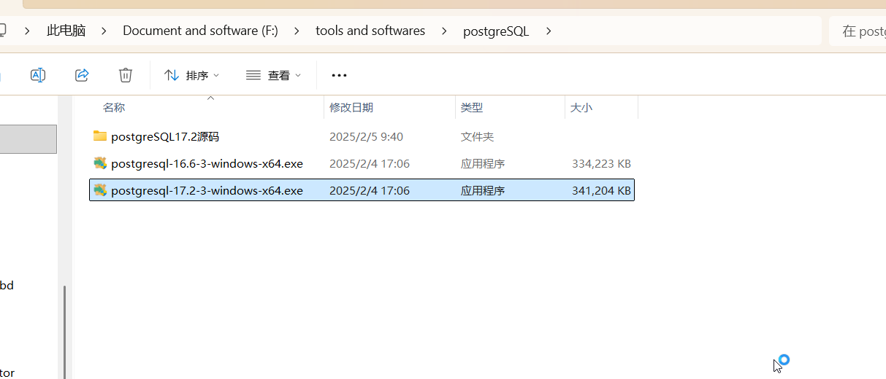

## 2，双击文件开始安装，弹出窗口后点击next，安装目录保存在C盘，点击next

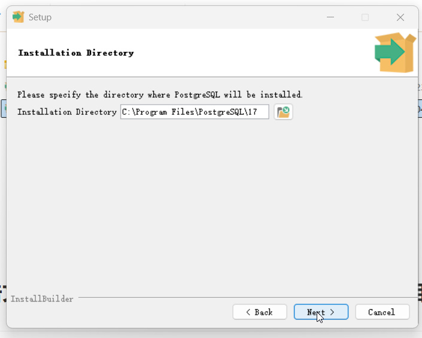

## 3.在Select Components里面把StackBuilder一项取消勾选，点击next

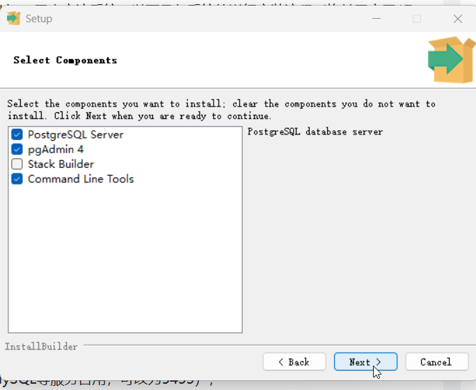

## 4.数据存储目录选择非系统盘，这里下载d:\PostgreSql\data,点击next

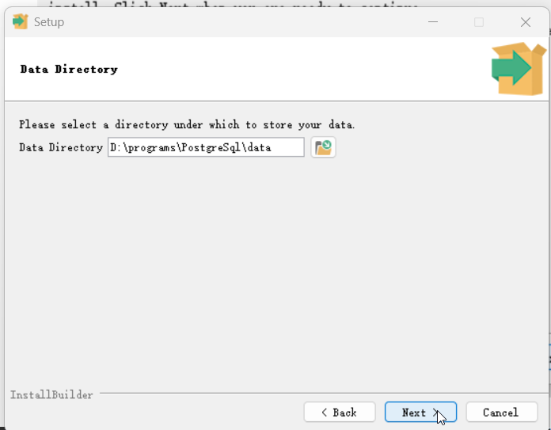

## 5.设置**超级用户密码**（`postgres`用户，后续连接数据库的关键密码，务必记住），这里是英文名+出生年份，点击next

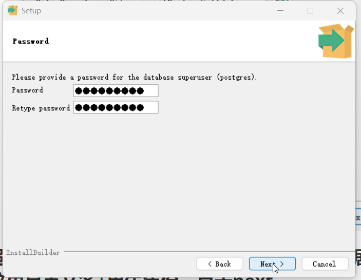

## 6.端口保存默认：5432，点击next

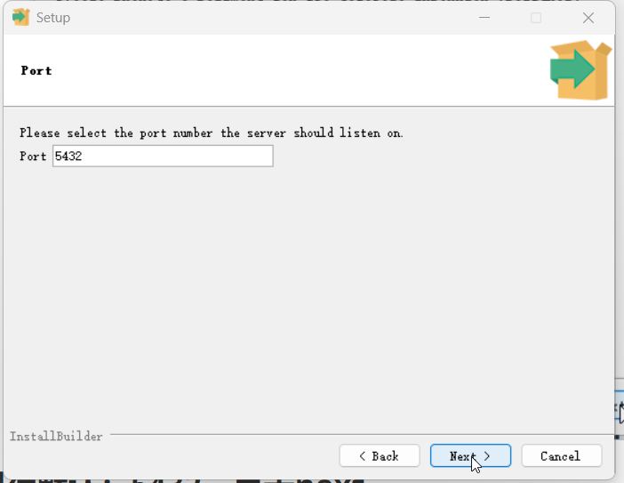

## 7.区域设置保持默认点击next

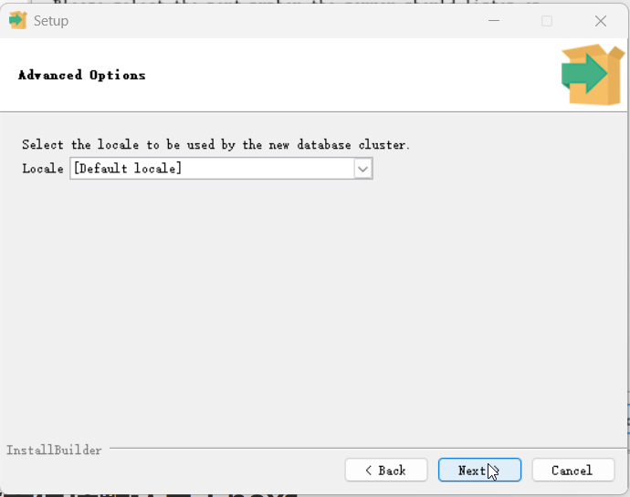

## 8.弹出摘要窗口，点击next

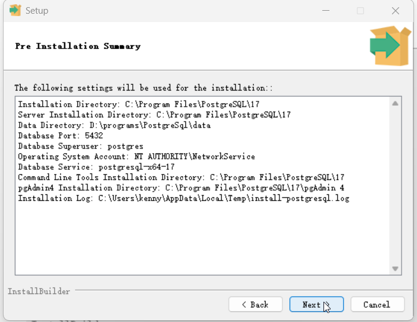

## 9.弹出准备好安装窗口，点击next,等待安装结束

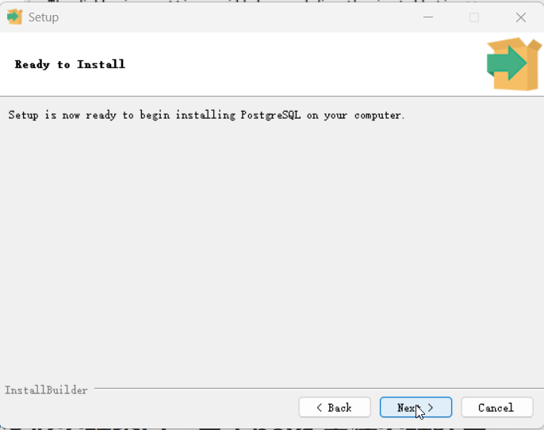

## 10.接下来就是安装，需要等待一点时间，

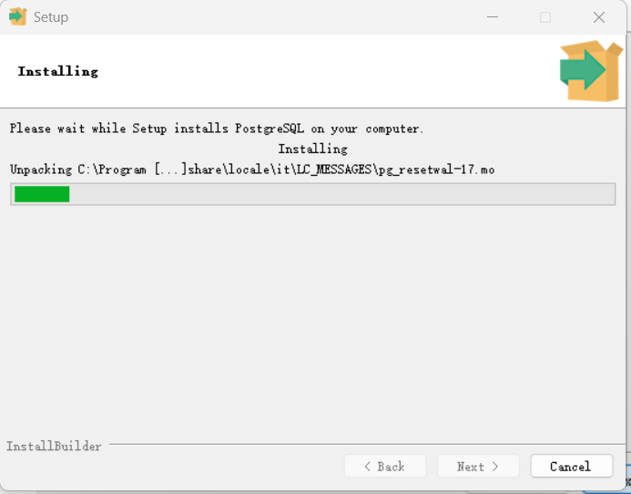

## 11.最后，点击finish完成安装

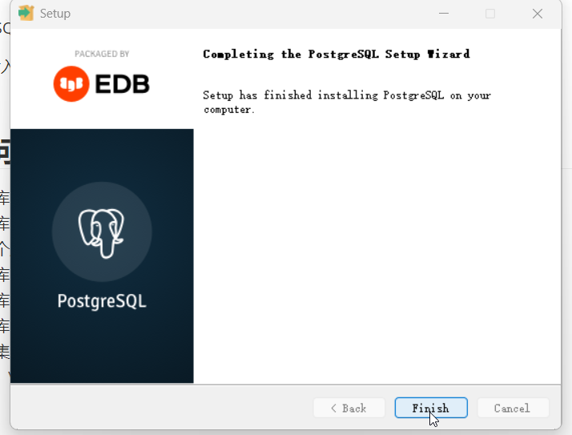

## 12.为了方便使用psql，我们需要把postgresql安装目录里面的bin文件夹的路径，如：C:\Program Files\PostgreSQL\17\bin添加到Path环境变量中

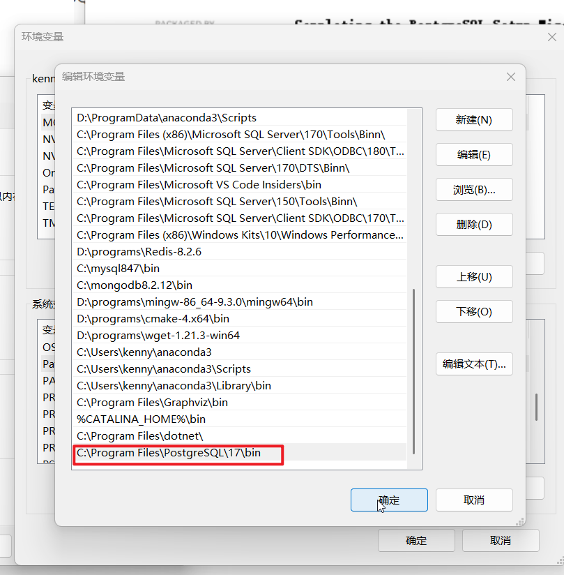

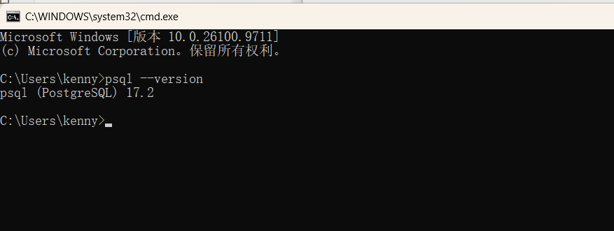