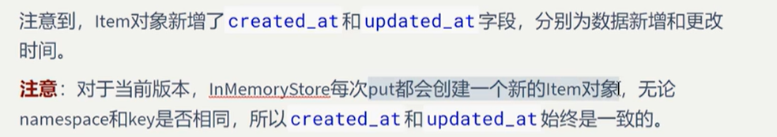

# 长期记忆1.基本API，put()/get()
## InMemoryStore


```python
from langgraph.store.memory import InMemoryStore

store = InMemoryStore()
namespace=("users",)
user_id = "user_1"
user_name="Jack"
store.put(namespace, user_id, {"name":user_name})
item = store.get(namespace, user_id)
print(item)
```

    Item(namespace=['users'], key='user_1', value={'name': 'Jack'}, created_at='2026-10-29T01:52:17.864709+00:00', updated_at='2026-10-29T01:52:17.864712+00:00')


### update data


```python
user_name = "Mary"
store.put(namespace, user_id, {"name":user_name})
item = store.get(namespace, user_id)
print(item)
```

    Item(namespace=['users'], key='user_1', value={'name': 'Mary'}, created_at='2026-10-29T01:53:05.322180+00:00', updated_at='2026-10-29T01:53:05.322182+00:00')

## 注意：


